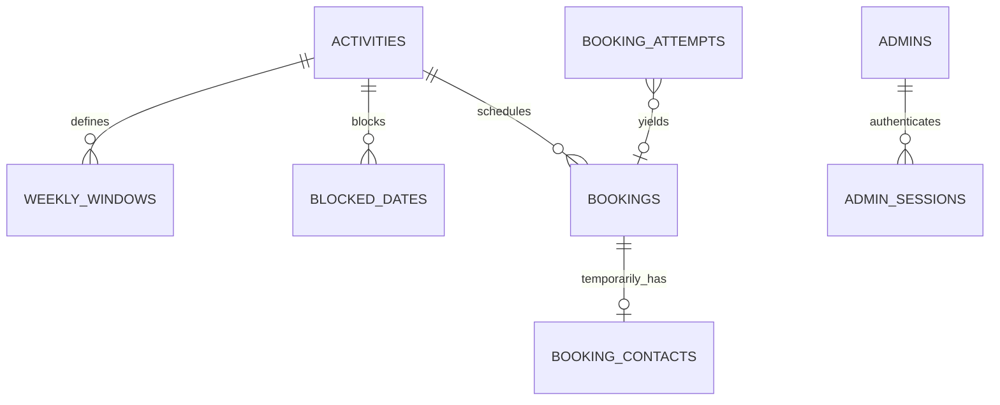

# SlotBook MVP proposed data model

Status: technical design approved by the human on 2026-10-25 as part of R-003;
T-02 remains provisional and T-03 conditional. No ORM models or migrations are created.
Baseline and product authority: `e9f16809058fe826523bf8c19387b6ba65b8e145`, `spec.md`,
constitution 1.2.0, plus approved A-001/A-003 and clarified A-002 (2026-10-25). Rationale: `research.md`. API proposal: `contracts/api-proposal.md`.

## Approved policy and provisional execution

A-002 is approved with a persisted database timestamp T, effective only after admission commits;
A-003 is approved for separately authorized unrecoverable disaster recovery. T-02's split execution
remains provisional pending runtime verification. See [retry-protocol.md](contracts/retry-protocol.md)
for the complete current protocol. No schema/application migration is implemented here.

## Relationships and storage boundaries

All IDs are opaque server-assigned UUIDs except private random credentials. Runtime schemas
are `public` for configuration/contact-free history and `private` for personal/security state.
The backup role can read only the explicit public allowlist; schema naming alone grants no protection.
No raw retry key, bearer token, guest data in JSON audit logs, or contact-bearing request archive.
Disable SQLAlchemy SQL echo, hide bound parameters, and disable PostgreSQL statement/error-parameter
logging for contact-bearing statements; redact headers in proxy/HTTP logs and disable core dumps.

| Entity | Proposed fields | Rules and lifecycle |
| --- | --- | --- |
| `activities` | id PK, slug UNIQUE, title, description, duration_minutes, timezone, is_active | Description 1–2000 Unicode code points after outer trim, multiline/plain text. Positive duration divisible by 15. IANA timezone validated against pinned tzdata. Slug/title retain existing semantics; no unapproved name/contact length rules. |
| `weekly_windows` | id PK, activity_id FK, iso_weekday, start_local_time, end_local_time | weekday 1–7; end > start within one local date; no duplicate/overlap for activity/weekday. Touching stays distinct. Local times have no timezone/offset. |
| `blocked_dates` | activity_id FK, local_date; composite PK | Exactly one activity-local date. Blocking does not mutate existing bookings. Repeated insert leaves the same block. |
| `bookings` | id PK, activity_id FK, starts_at timestamptz, ends_at timestamptz, status, canceled_at nullable timestamptz | Only approved retained history: reference/activity/start/end/status/original cancellation time. No contact fields, free text, created-at history, attempt credential, or mutable duration snapshot. Start/end immutable after confirmation. |
| `private.booking_contacts` | booking_id PK/FK, attendee_name, attendee_email, delete_at timestamptz | Zero or one row per booking. Name/email both present or row absent. Deadline derived from immutable end or original cancellation; indexed for deletion. Excluded from all backups/exports. |
| `private.booking_attempts` | generation + key_digest composite PK, first_received_at NOT NULL, expires_at NOT NULL, state, booking_id nullable FK, rejection_status/code and safe field codes nullable | Key digest is HMAC of full private key with server secret; raw key never stored. States admitted/succeeded/rejected/expired. DB timestamp T and E=T+24h commit with original binding under approved A-002; immutable thereafter. Delayed COMMIT consumes the fixed window and may make the key expired immediately. Result and booking link are removed at expiry; minimal expiry tombstone retained for accepted generation. No contact values. |
| `private.attempt_bindings` | generation + key_digest PK/FK, payload_fingerprint | HMAC of versioned canonical submission; treated as derived personal data, excluded from backups and removed on expiry or earlier applicable contact deadline. No raw request copy. |
| `private.retry_generation` | singleton id, generation, created_at | Random public restore epoch, retained across normal restarts/transient failures; approved A-003 permits change only after a separately approved unrecoverable, fenced restore. Missing state fails readiness. Never imported from backup. |
| `private.recovery_events` | event reference, restored_at, snapshot reference, old generation if known, new generation, state-loss reason | Privacy-safe operator recovery record, no guest keys/contacts; generation invalidation allowed only under approved A-003 and separately approved restore. |
| `private.worker_status` | singleton id, last heartbeat, last successful purge, overdue count, safe failure code | Private operational state for readiness/status only; no contacts or credentials; excluded from backups. |
| `private.admins` | id PK, email UNIQUE, password_hash | One seeded admin; Argon2; configured development credentials only. Seed rerun preserves existing credentials. Reprovision after restore, not from booking-history backup. |
| `private.admin_sessions` | token_digest PK, admin_id FK, issued_at, expires_at | Opaque bearer verifier, absolute expiry = issued_at + 60 elapsed minutes. No extension/refresh; expired sessions removed by worker. Excluded from backups. |

Activity FKs use RESTRICT on deletion: the MVP offers active/inactive management, not hard deletion.
Removing a contact row never deletes the booking. Attempt deletion must never cascade to a booking.
Inactive activities and saved schedules remain readable through protected admin operations.

## Constraints and indexes

- `bookings`: NOT NULL endpoints, `starts_at < ends_at`, status in confirmed/canceled,
  confirmed implies null canceled_at, canceled implies non-null canceled_at. A partial GiST
  exclusion on `(activity_id WITH =, tstzrange(starts_at, ends_at, '[)') WITH &&)` applies only
  to status confirmed; enable `btree_gist`. Keep ADR-0002 unchanged until any reviewed supplement.
- `weekly_windows`: weekday and endpoint checks, plus a GiST exclusion on activity, weekday,
  and a half-open numeric range of local-clock microseconds. This preserves fractional time
  precision without assuming all boundaries are minute-aligned. Touching ranges do not overlap.
  Schedule replacement validates the complete set and replaces it in one transaction.
- Index bookings by `(activity_id, starts_at)` and `(status, starts_at)` as needed for availability
  and admin history; avoid redundant indexes before examining query plans. GiST handles overlap.
- Index `booking_contacts.delete_at`, attempt expiry, and session expiry for cleanup.
  Key-digest uniqueness serializes admission of the same identifier.
- No time-dependent CHECK constraint attempts to enforce current notice or expiry: those use
  authoritative time during transactions. Database constraints enforce stable row invariants.
- Backups allowlist configuration tables and all six booking-history fields, never `SELECT *`
  over future additions. No database column alone authorizes a public or admin response.

## Booking attempt state machine and transaction boundaries

The complete proposed state machine, admission contention, execution contention, classification
priority, rollback paths and crash cases are in [retry-protocol.md](contracts/retry-protocol.md).
Use that single protocol instead of duplicating a less precise algorithm here.

Admission transaction: claim unique key and binding, then stamp final DB-generated T/E late in
this new, uncommitted transaction, after key contention/binding preparation. Derive E=T+24h from
one clock_timestamp() sample; commit T/E and binding atomically. Existing committed winners never
restamp. first_received_at/expires_at are non-null paired values; no transaction identity,
receipt-resolution state, post-commit metadata or worker sealing is required.

Only successful durable commit makes admission valid. If actual commit C is delayed, remaining
validity is max(0,E-C), not 24h from C. A key committed at/after E is already expired, with no booking,
pending or result access. Use bounded admission waits/budgets but treat timed-out COMMIT as unknown
until a fresh read resolves it. Require fsync/synchronous_commit on, durable volumes and UTC sessions.
Known rollback creates no valid admission through that transaction; uncertain outcome returns
unverified 503, never confirmation. Normal restart retains committed T/E/binding/generation.

Execution transaction: lock attempt NOWAIT; verify original T/binding/current expiry; lock activity
with bounded waiting; refresh rules and DB wall-clock time; check A-001/window/notice/horizon;
insert booking/contact inside a savepoint; atomically commit success or terminal rejection with
the result. Only confirmed commit permits confirmation. Named exclusion violation rolls back the
savepoint and records terminal 409; other execution failures roll back the whole transaction.

After a lock timeout/NOWAIT/deadlock, use a fresh READ COMMITTED transaction to classify committed
state. 202 requires proven committed matching unexpired unfinished admission with known T/E;
changed details yield 409, expired key 410, and unresolved admission/execution 503. A failed or
unknown COMMIT is never assumed to mean no booking exists. Concurrent matching retries either
observe a committed final result or acquire the same row and execute at most once.

Lock order: attempt → activity → booking → contact; binding follows its attempt. Config/cancel
start at activity. Worker expiry locks attempt then binding only; contact purge
locks contacts only and rechecks due state; no worker then acquires an earlier-order parent lock.
Process batches deterministically in small transactions. Fresh clock_timestamp() checks follow
waits; never rely on transaction-start now(). PostgreSQL tests must verify this design.

Expired rows retain non-authorizing tombstones while their generation remains accepted. Under
approved A-003, only a separately approved unrecoverable restore fences old writers and changes
generation before serving, with recovery metadata. Noncurrent keys return 409
attempt_invalidated_by_restore, not 410 chronological expiry. Normal restarts never rotate it.
No booking interval is rewritten and no contact is added to any attempt/recovery structure.

## Administrator transitions and warnings

`confirmed -> canceled` is the sole booking mutation. Resolve booking's activity without a row
lock, lock activity then booking, re-read, check session authorization, and update status and
first cancellation time exactly once. Update contact delete_at = first cancellation + 720h in
the same transaction. Concurrent/repeated cancellation keeps that original timestamp; 204 means
current state canceled, even on replay. No history-contact restoration occurs.

Activity edits, weekly-window replacement and blocking lock the activity and preserve all
booking endpoints/statuses. Compute a conservative affected-confirmed-booking count against the
proposed rules/details, including duration/timezone/active-status changes. Return it through
contracted `X-Preserved-Booking-Count`; UI clearly warns that existing appointments remain and
must be canceled individually if desired. No guest contacts are needed to compute the count.

## Contact lifecycle and recovery

- On creation, `delete_at = recorded ends_at + 720 elapsed hours`; on first cancellation it is
  replaced by `original canceled_at + 720h`. Repeated cancellation/configuration/retries do not
  modify the anchor. At the deadline a dedicated worker deletes the contact row.
- Every protected read projects contacts only if present AND current database wall-clock time
  is before the deadline derived from booking state. A private stored deadline is an index
  aid, not authority to extend retention. Responses use an explicit removed discriminator.
- Do not put contact payloads in attempt results, cookies, traces, database statement logs, audit
  events, or exception detail. Binding digests expire at 24h, earlier than any ordinary booking
  contact deadline; keep that minimum rule explicit for cancellation and recovery.
- The worker wakes for the earliest due deadline, is notified on new earlier deadlines, and
  has a periodic fallback plus startup catch-up. It deletes in bounded transactions, rechecks
  authoritative time, and can use SKIP LOCKED; skipped due rows remain an immediate overdue
  error, not “success.” Failures expose only counts/timestamps/safe error codes to operators.
- One logical snapshot includes approved configuration and contact-free history only. Exclude
  all private schemas, statement/request logs, physical volumes, WAL archives, and core dumps
  from backup tools. CI inspects both backup bytes and a restored database with synthetic markers.
- Under approved A-003, a separately approved unrecoverable restore runs migrations and restores
  allowed data; reapply constraints before serving, fence old writers, record the recovery event,
  provision a fresh admin and generation, and leave contacts/sessions/attempts empty. Returning contact state
  is removed even before an original deadline. This does not promise irreversible anonymity:
  a booking's activity/time/reference could still be correlated externally.

## Time and derived availability

UTC instants are authoritative; IANA identifiers define availability and display. Full window
portion construction is described in R-07. Under approved A-001, enumerate exact activity-local
clock minutes 00/15/30/45 with zero seconds/fractional seconds and both fold values, reject
non-round-tripping labels, deduplicate UTC instants,
then require `[start,end)` to fit one portion of one window. End may equal the portion boundary.
P-01 is resolved by A-001. Do not anchor starts to the window opening, visitor zone, or a UTC
quarter-hour rule. Keep window boundaries as configured: 09:10–10:00 with a 30-minute activity
yields 09:15 and 09:30; 09:10–09:40 yields none when otherwise eligible. Direct off-grid requests
are rejected, never rounded. Eligible repeated aligned starts retain both distinct UTC offsets.
Existing bookings are preserved; no table/field/backfill migration follows from this refinement.

For a visitor-selected date/timezone, search a finite UTC envelope covering all possible offsets
for that date, retain only instants that convert to that exact local date, then enumerate every
activity-local date intersecting it. Do not assume there are exactly two dates or 24 hours.
Working windows and blocked dates still use activity dates. Sort/deduplicate by UTC start,
filter occupancy and inclusive notice/horizon using one current T per query. Booking submission
independently repeats eligibility at a fresh T. Repeated local labels carry offsets in UI;
API values remain UTC. Changing display zone changes labels, never selected UTC instants.

## Migration sequence (design, not executable migration code)

1. Establish Alembic baseline, `btree_gist`, schemas and restricted roles.
2. Create configuration and permitted booking-history tables, stable CHECK/FK/UNIQUE/GiST rules.
3. Create private contacts, attempts/bindings with non-null immutable T/E, retry generation,
   recovery events, admin and session tables/indexes. Validate durable commit/storage settings;
   ordinary DB-generated timestamps replace all proposed commit-metadata machinery.
4. Initialize one generation and an explicitly configured development/test admin and synthetic
   activity/windows. Seeds are idempotent and do not alter already-booked intervals or passwords.
5. Verify empty upgrade, repeat startup, and allowlisted backup/restore into a separate empty DB.
   No live data migration is needed for the current scaffold. Any future populated-schema
   migration requires its own backfill/compatibility review; never invent descriptions or contacts.

Rollback is a reviewed operator procedure; schema downgrades/drops are not automatic runtime
recovery. No migration, downgrade, database reset, or restore is executed during planning.
