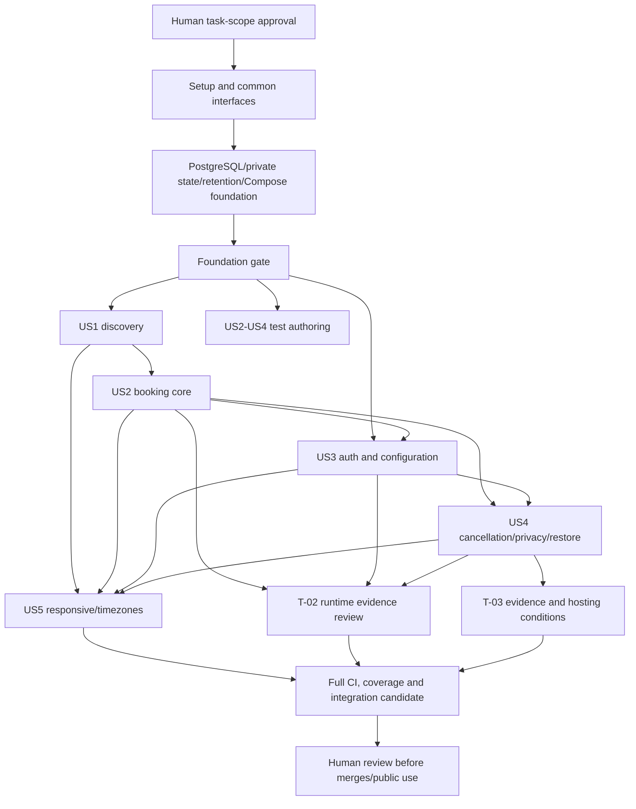

# Tasks: SlotBook Appointment Scheduling MVP

**Generated / refined**: 2026-10-25. **Status**: approved task plan; T001 complete after verified committed handoff; 91 tasks remain unchecked and unstarted.
**Original baseline approval scope**: The human project owner approved the refined 92-task plan and protocol,
subject to final file verification, and authorized only their baseline commit. This records task
approval, not permission to start execution, create worktrees, launch agents, push, merge or deploy.
**Current scoped authorization (2026-10-25)**: The human subsequently authorized T001 only.
The human subsequently authorized T001 finalization and its local documentation commit.
H0 is satisfied for that handoff scope, not any other task or agent/worktree setup.
The [handoff record](../../docs/IMPLEMENTATION_BASELINE.md) records the reviewed source and
publication checks. T001 was marked complete only after its handoff was committed and verified;
completion metadata is finalized in the new local baseline. No T002–T092 execution, push,
merge, deploy or recovery is authorized by this turn.
**Frozen source baseline**: `adc0b83a4408493ac44d3a7571dfd3d25a758679` on actual branch
`001-appointment-scheduling` (verified clean before generation; one local commit ahead of origin).
**Inputs**: [constitution](../../.specify/memory/constitution.md), [spec.md](spec.md),
[approved amendments](amendments/), [plan.md](plan.md), [research.md](research.md),
[data-model.md](data-model.md), [quickstart.md](quickstart.md),
[shared ownership](../../docs/AGENT_TASKS.md), [canonical API v1](../../contracts/main.tsp),
[frozen review](contracts/canonical-review.md), [retry protocol](contracts/retry-protocol.md),
and [execution protocol](../../docs/EXECUTION_PROTOCOL.md) (approved coordination baseline; only T001 finalization/local commit is authorized).

## Authority, format and ownership

H0 is the external **explicit human authorization to begin execution against the approved task
scope, ownership and checks**. Approval and commitment of this documentation baseline alone do
not satisfy H0 or authorize agents, worktrees or code. The human separately authorized this
baseline commit only. Future integration/merges and real restore/destructive operations retain
separate human approval. Crash/restore drills may run only within explicitly approved disposable
test targets; production and ordinary developer databases are never implicit test targets.

Each line has checkbox, sequential ID, optional [P], story label only in story phases, owner,
exact repository-relative output paths, explicit dependencies, measurable acceptance and references.
`[P]` means file-disjoint work can run concurrently **after all listed dependencies are complete**;
it never bypasses H0/foundation or means the whole story can run before its services exist.
Unmarked tasks may also be scheduled concurrently only after Lead checks paths/owner capacity.
Real test runs also require separate target projects or an exclusive target run lock; mutating
suites cannot reset/restart another suite's database. No two concurrent tasks may edit the same file; tasks sharing App.tsx, app/main.py, migration
chain, package locks, CI or Compose are ordered in the dependencies below.

Lead/Architect owns shared docs/scripts, approval/integration evidence, canonical TypeSpec,
OpenAPI and generated TS. Frontend owns frontend/** plus its Dockerfile, except
frontend/src/api/schema.d.ts. Backend owns backend/** including migrations/tests/worker and its
Dockerfile. QA/DevOps owns tests/**, .github/** and root Compose, never component Dockerfiles.
No task permits independent modification of the frozen trio:
`contracts/main.tsp`, `contracts/tsp-output/@typespec/openapi3/openapi.yaml`,
`frontend/src/api/schema.d.ts`. Regeneration may verify no drift; any semantic change stops
for the Lead-owned proposal/compatibility/human-approval process, not an implementation workaround.

**Tests are required** by the constitution, specification and this request. Author feature tests
first and record a meaningful failure (not a broken environment); then implement and show green
at the milestone. A test-authoring task may finish with demonstrated red assertions; integration
checkpoints require them green. All commands in this file are future implementation acceptance
commands; no missing feature suite or application feature was executed/implemented by generation.
Only document/coverage/dependency checks are performed now. All five stories are required; P3
usability/time correctness is not optional. The 16/16 requirements checklist is preserved and
is not a runtime test score.

Historical planning/quickstart/ownership text predates this freeze and task file; adc0b83 and the
freeze record supply the current contract authority. The first Lead handoff task updates the
shared guide's stale status only, retaining its ownership rules. No product decision is reopened. The execution protocol resolves I3/I4/I6 handoffs without
changing shared ownership; T001 records its reviewed revision before execution.

## Phase 1: Setup — M0: reviewed shared tools and interfaces

**Goal**: Prepare isolated ownership, locks, test tooling, component image interfaces and early CI.

**Independent verification / checkpoint**: Review task authorization/baseline, install locked dependencies, collect real tests and prove generation no-diff. QA can author CI/test harnesses while component owners prepare their own builds.

- [X] T001 Owner: Lead/Architect — Publish the approved task revision, component interfaces and isolated-worktree handoff; correct historical no-tasks/no-freeze status without changing ownership. Paths: `docs/IMPLEMENTATION_BASELINE.md`, `docs/AGENT_TASKS.md`, `docs/EXECUTION_PROTOCOL.md`. Depends: H0. Accept: All owners start from one reviewed committed descendant of adc0b83 containing approved tasks/protocol; record full baseline/component hashes and protocol revision, component image/CLI handoffs, isolated projects/ports and per-milestone evidence manifest. QA uses selected clean component contexts without branch merges; correct the shared guide status. No agent starts before H0; no credentials or machine-specific state enter committed records.
  T001 completion (2026-10-25): documentation/interface/isolation handoff committed and verified
  before this marker was set; verification is recorded in docs/IMPLEMENTATION_BASELINE.md.
  Completion metadata is finalized in the new local baseline. T002–T005 are dependency-ready;
  all downstream tasks remain unstarted and require separate authorization.

- [ ] T002 [P] Owner: Backend — Lock the declared backend runtime/test dependencies and configure pytest markers, static checks and private test fixtures. Paths: `backend/requirements.txt`, `backend/requirements.lock`, `backend/pyproject.toml`, `backend/pytest.ini`, `backend/tests/__init__.py`, `backend/tests/conftest.py`, `backend/tests/support/__init__.py`, `backend/tests/support/clock.py`, `backend/tests/support/faults.py`. Depends: T001. Accept: Python 3.12 locked install includes pinned development Ruff/mypy and tzdata; from backend/, python -m ruff check app tests, python -m ruff format --check app tests and python -m mypy app execute, with no blanket suppressions. Pytest markers collect with importlib mode; private clock/fault interfaces and subprocess fixtures follow the execution protocol, never HTTP parameters/routes or production test switches. Record compatibility warnings.

- [ ] T003 [P] Owner: Frontend — Add a locked Playwright-based frontend test command and frozen-contract fixture validation. Paths: `frontend/package.json`, `frontend/package-lock.json`, `frontend/playwright.config.ts`, `frontend/tests/fixtures/api.ts`, `frontend/tests/scaffold.spec.ts`. Depends: T001. Accept: npm ci, npm run build and npm run test collect a real baseline; pin Playwright package/browser revision through the lock and record versions. Generated schema.d.ts is read-only; typed fixtures match API v1; JUnit output uses the per-run private report directory for QA sanitization; no new production test routes or persisted credentials.

- [ ] T004 [P] Owner: QA/DevOps — Create QA-owned locked HTTPX/schema and Playwright harnesses with redacted evidence output. Paths: `tests/requirements.txt`, `tests/requirements.lock`, `tests/pytest.ini`, `tests/conftest.py`, `tests/harness/runner.py`, `tests/harness/targets.py`, `tests/harness/evidence.py`, `tests/contract/test_schema_fixtures.py`, `tests/e2e/package.json`, `tests/e2e/package-lock.json`, `tests/e2e/playwright.config.ts`, `tests/Dockerfile`. Depends: T001. Accept: Locked HTTPX/schema/Playwright tools collect black-box tests without app imports; pin QA FROM images by release and digest and the browser revision by lock. Host runner supplies check/run/collect commands, validates disposable target manifest/approval scope, and publishes allowlisted evidence to ignored test-results/<run-id>/; raw fixtures/control/JUnit stay private. Initially verify guard/redaction tests; lifecycle adapters become executable in T022. HAR, sensitive screenshots, traces, videos and storage dumps remain disabled.

- [ ] T005 Owner: Lead/Architect — Promote generation/schema/type drift checks into a shared executable verification entry point without editing frozen inputs. Paths: `scripts/check-contract.sh`, `scripts/check-contract.mjs`. Depends: T001. Accept: Compile TypeSpec, validate OpenAPI and generated TS, then git diff --exit-code against all three frozen files; fail on changed paths/statuses/security/headers, unsafe public/contact-removed shapes or zero fixtures. Canonical and generated bytes stay frozen.

- [ ] T006 Owner: QA/DevOps — Author initial GitHub Actions generation/build/unit jobs independently of feature implementation. Paths: `.github/workflows/ci.yml`. Depends: T004, T005, T002, T003. Accept: Node 22/Python 3.12 locked installs, contract no-diff, frontend type/build and backend Ruff/mypy/unit commands execute; record image and timezone/browser versions. Future suites are explicit, missing tests cannot silently pass; no deployment job, credentials or body-bearing artifacts.

- [ ] T007 [P] Owner: Backend — Build the backend image from its lock and publish migration/seed/worker/health CLI interfaces for QA. Paths: `backend/Dockerfile`, `backend/.dockerignore`. Depends: T002. Accept: Pin every FROM to an exact Python 3.12 patch release plus verified immutable digest; lock Python/tzdata packages, set PYTHONTZPATH="" to select packaged tzdata and TZ=UTC, and report package/IANA versions. Image imports app, runs pytest/static commands and publishes migration/seed/worker/health CLI interfaces; excludes .venv/.env/caches, no migration per API replica. Missing configured tzdata fails validation; do not invent digest values in documentation.

- [ ] T008 [P] Owner: Frontend — Build the frontend image and publish its serving/API-origin interface for QA. Paths: `frontend/Dockerfile`, `frontend/.dockerignore`. Depends: T003. Accept: Pin every FROM to an exact Node 22 patch/base release plus verified immutable digest; locked build succeeds and records image/browser versions. Publish VITE_API_BASE_URL build/start behavior for the QA-assigned loopback API port; exclude secrets/node_modules/private state. QA consumes the image without editing this Dockerfile.

---

## Phase 2: Foundational — M1: blocking persistence/security infrastructure

**Goal**: Provide PostgreSQL migrations, private-state boundaries, common HTTP behavior, clock/seed/retention/readiness and reproducible Compose before story work.

**Independent verification / checkpoint**: Empty/repeat migrations, actual GiST/role/check tests, exact cleanup boundaries and cold/repeat startup pass. The dedicated contact worker exists before guests can create personal data. All stories depend on the foundation gate.

- [ ] T009 Owner: Backend — Create SQLAlchemy session/model base and Alembic environment with PostgreSQL durability checks. Paths: `backend/app/db/session.py`, `backend/app/db/base.py`, `backend/app/models/__init__.py`, `backend/alembic.ini`, `backend/migrations/env.py`, `backend/migrations/versions/0001_schemas.py`. Depends: T002, T007. Accept: Empty PostgreSQL 16 upgrade creates public/private schemas, least-privilege runtime/backup roles, explicit ACLs and btree_gist; no embedded passwords or default backup grants on future tables; fsync/synchronous_commit are on and sessions UTC; READ COMMITTED transaction scopes never share sessions across threads.

- [ ] T010 Owner: Backend — Write failing PostgreSQL migration/constraint/role tests before the mapped tables. Paths: `backend/tests/integration/test_migrations.py`, `backend/tests/integration/test_constraints.py`, `backend/tests/integration/test_roles.py`. Depends: T009. Accept: Tests fail on absent tables/constraints, use independent real PostgreSQL connections, and cover exclusion, adjacency, RESTRICT FKs, stable checks, private role access and forbidden backup reads; SQLite substitution is rejected.

- [ ] T011 Owner: Backend — Map configuration tables and their atomic schedule constraints. Paths: `backend/app/models/activity.py`, `backend/app/models/availability.py`, `backend/app/models/__init__.py`, `backend/migrations/versions/0002_configuration.py`. Depends: T010. Accept: Migrations preserve exact source constraints and explicit configuration backup grants, accept touching windows, reject duplicate/overlap/overnight windows and enforce slug uniqueness; positive/negative migration tests pass for these tables. Covers: FR-002, FR-015, FR-016, FR-027, FR-031.
  Verbatim data-model constraints for `activities` — fields: id PK, slug UNIQUE, title, description, duration_minutes, timezone, is_active; rules: "Description 1–2000 Unicode code points after outer trim, multiline/plain text. Positive duration divisible by 15. IANA timezone validated against pinned tzdata. Slug/title retain existing semantics; no unapproved name/contact length rules."
  Verbatim data-model constraints for `weekly_windows` — fields: id PK, activity_id FK, iso_weekday, start_local_time, end_local_time; rules: "weekday 1–7; end > start within one local date; no duplicate/overlap for activity/weekday. Touching stays distinct. Local times have no timezone/offset."
  Verbatim data-model constraints for `blocked_dates` — fields: activity_id FK, local_date; composite PK; rules: "Exactly one activity-local date. Blocking does not mutate existing bookings. Repeated insert leaves the same block."

- [ ] T012 Owner: Backend — Map immutable booking history and isolated ephemeral contacts; add the named GiST exclusion. Paths: `backend/app/models/booking.py`, `backend/app/models/contact.py`, `backend/app/models/__init__.py`, `backend/migrations/versions/0003_bookings.py`. Depends: T011. Accept: Enforce "starts_at < ends_at", "status in confirmed/canceled", "confirmed implies null canceled_at, canceled implies non-null canceled_at" and partial exclusion on same-activity confirmed [start,end); contacts never enter history; backup role reads exactly the six history fields, not private contacts; adjacency works. Covers: FR-009, FR-017, FR-025.
  Verbatim data-model constraints for `bookings` — fields: id PK, activity_id FK, starts_at timestamptz, ends_at timestamptz, status, canceled_at nullable timestamptz; rules: "Only approved retained history: reference/activity/start/end/status/original cancellation time. No contact fields, free text, created-at history, attempt credential, or mutable duration snapshot. Start/end immutable after confirmation."
  Verbatim data-model constraints for `private.booking_contacts` — fields: booking_id PK/FK, attendee_name, attendee_email, delete_at timestamptz; rules: "Zero or one row per booking. Name/email both present or row absent. Deadline derived from immutable end or original cancellation; indexed for deletion. Excluded from all backups/exports."

- [ ] T013 Owner: Backend — Map attempt/binding/generation/recovery state and immutable receipt/deadline constraints. Paths: `backend/app/models/attempt.py`, `backend/app/models/recovery.py`, `backend/app/models/__init__.py`, `backend/migrations/versions/0004_attempts.py`. Depends: T012. Accept: Unique generation/key digest serializes admission; T/E and binding commit together; stable CHECK enforces E=T+24 elapsed hours, no now()-dependent CHECK; expiry drops binding/result links but preserves non-authorizing tombstone; no attempt cascade deletes a booking. Covers: FR-024, FR-029.
  Verbatim data-model constraints for `private.booking_attempts` — fields: generation + key_digest composite PK, first_received_at NOT NULL, expires_at NOT NULL, state, booking_id nullable FK, rejection_status/code and safe field codes nullable; rules: "Key digest is HMAC of full private key with server secret; raw key never stored. States admitted/succeeded/rejected/expired. DB timestamp T and E=T+24h commit with original binding under approved A-002; immutable thereafter. Delayed COMMIT consumes the fixed window and may make the key expired immediately. Result and booking link are removed at expiry; minimal expiry tombstone retained for accepted generation. No contact values."
  Verbatim data-model constraints for `private.attempt_bindings` — fields: generation + key_digest PK/FK, payload_fingerprint; rules: "HMAC of versioned canonical submission; treated as derived personal data, excluded from backups and removed on expiry or earlier applicable contact deadline. No raw request copy."
  Verbatim data-model constraints for `private.retry_generation` — fields: singleton id, generation, created_at; rules: "Random public restore epoch, retained across normal restarts/transient failures; approved A-003 permits change only after a separately approved unrecoverable, fenced restore. Missing state fails readiness. Never imported from backup."
  Verbatim data-model constraints for `private.recovery_events` — fields: event reference, restored_at, snapshot reference, old generation if known, new generation, state-loss reason; rules: "Privacy-safe operator recovery record, no guest keys/contacts; generation invalidation allowed only under approved A-003 and separately approved restore."

- [ ] T014 Owner: Backend — Map the single-admin, absolute session expiry and privacy-safe worker status tables. Paths: `backend/app/models/admin.py`, `backend/app/models/worker.py`, `backend/app/models/__init__.py`, `backend/migrations/versions/0005_security_worker.py`. Depends: T013. Accept: Argon2/hash/verifier fields contain no raw credentials; deadline/lookup indexes exist; repeat upgrade is a no-op; all foundational DB tests pass. No time-dependent CHECK or extra retained booking-history fields. Covers: FR-013, FR-014, FR-028, FR-025.
  Verbatim data-model constraints for `private.worker_status` — fields: singleton id, last heartbeat, last successful purge, overdue count, safe failure code; rules: "Private operational state for readiness/status only; no contacts or credentials; excluded from backups."
  Verbatim data-model constraints for `private.admins` — fields: id PK, email UNIQUE, password_hash; rules: "One seeded admin; Argon2; configured development credentials only. Seed rerun preserves existing credentials. Reprovision after restore, not from booking-history backup."
  Verbatim data-model constraints for `private.admin_sessions` — fields: token_digest PK, admin_id FK, issued_at, expires_at; rules: "Opaque bearer verifier, absolute expiry = issued_at + 60 elapsed minutes. No extension/refresh; expired sessions removed by worker. Excluded from backups."

- [ ] T015 [P] Owner: Backend — Implement strict Python request/response/error schemas matching the frozen body unions and preprocessing rules. Paths: `backend/app/schemas/common.py`, `backend/app/schemas/activity.py`, `backend/app/schemas/booking.py`, `backend/app/schemas/auth.py`, `backend/tests/unit/test_schemas.py`. Depends: T002. Accept: Unknown body fields fail; trim description before counting Unicode code points; retain exact attendee identity strings; UUID/aware-time/email/LocalClock constraints and present/removed union match OpenAPI; no raw validator values escape. Covers: FR-007, FR-019, FR-022, FR-031.

- [ ] T016 Owner: Backend — Establish app factory, contracted exception translation, no-store and explicit-origin CORS/redaction. Paths: `backend/app/main.py`, `backend/app/api/errors.py`, `backend/app/api/middleware.py`, `backend/tests/contract/test_common_errors.py`, `backend/tests/support/server.py`. Depends: T015, T014. Accept: Malformed JSON/type/extra fields map to safe 400; common 500/503 bodies, no-store/CORS and redaction match v1; no 422/HTML/body/token/contact logging. Backend-owned test-only server factory injects private clock/fault adapters through Python dependencies; ordinary entrypoint never reads test control. Auth-before-parse remains for T054; no test HTTP API. Covers: FR-007, FR-014, FR-019, FR-022.

- [ ] T017 Owner: Backend — Provide explicit repeatable synthetic development seeds and first-start generation initialization. Paths: `backend/app/cli/seed.py`, `backend/tests/integration/test_seed.py`. Depends: T014. Accept: Dedicated development/test mode seeds one Argon2 admin and future activity/windows from runtime configuration; rerun preserves passwords/bookings/generation. Routine missing established generation/HMAC state fails closed, never silently rotates it. Covers: FR-013, FR-024.

- [ ] T018 [P] Owner: Backend — Provide injectable authoritative wall-clock and pinned IANA conversion primitives. Paths: `backend/app/time.py`, `backend/tests/unit/test_time_primitives.py`, `backend/tests/support/clock.py`. Depends: T002. Accept: Production samples DB clock_timestamp() after waits; elapsed UTC boundaries and offset normalization are tested. Python zoneinfo uses locked tzdata via empty PYTHONTZPATH, reports package/IANA versions and rejects missing data. Test adapter reads protected per-run control only when explicitly injected by a test entrypoint; controlled-time cases are labeled separately from real-clock durability/concurrency evidence. Covers: FR-008, FR-021, FR-026, FR-028, FR-030.

- [ ] T019 Owner: Backend — Write failing tests for exact deadline erasure, read suppression, worker failure reporting and cleanup lock order. Paths: `backend/tests/unit/test_retention.py`, `backend/tests/integration/test_worker_cleanup.py`. Depends: T014, T018. Accept: Controlled end/cancel +720h boundary cases and overdue failure cases fail without the worker; attempt expiry preserves tombstones/removes bindings and sessions expire without renewal; tests assert no earlier-order parent lock acquisition. Covers: FR-019, FR-024, FR-025, FR-028, FR-029.

- [ ] T020 Owner: Backend — Implement the shared retention/session/attempt cleanup service and dedicated worker before accepting contact-bearing bookings. Paths: `backend/app/services/retention.py`, `backend/app/workers/retention.py`, `backend/app/cli/retention_status.py`, `backend/tests/support/worker.py`. Depends: T019. Accept: Deadline scheduling plus periodic/startup catch-up delete due contacts transactionally; skipped rows remain overdue, status has counts/timestamps only; bounded cleanup obeys attempt→binding or contact-only order. Private test-worker entrypoint injects the same controlled clock/barriers as the test server; default worker has no control channel. T-03 evidence remains pending. Covers: FR-019, FR-024, FR-025, FR-028, FR-029.

- [ ] T021 Owner: Backend — Implement contracted health/readiness adapters and durability/generation/worker preflight. Paths: `backend/app/api/operations.py`, `backend/app/cli/readiness.py`, `backend/tests/contract/test_operations.py`, `backend/app/main.py`. Depends: T016, T017, T020. Accept: GET /health returns status=ok + no-store; /ready returns status=ready only for DB/schema/durability/generation/worker readiness, otherwise generic contracted 503 with no diagnostics; no new operational HTTP endpoint. Covers: FR-019, FR-022, FR-024.

- [ ] T022 [P] Owner: QA/DevOps — Wire the six approved runtime services and isolated optional QA test profile. Paths: `docker-compose.yml`, `tests/compose.test.yml`, `tests/compose.integration.yml`, `tests/compose.faults.yml`, `tests/harness/runner.py`. Depends: T007, T008, T009, T017, T020, T021, T004. Accept: DB healthy→migrate→explicit dev seed→backend/retention ready→frontend; exact PostgreSQL 16 release/digest, durable UTC DB internal by default. QA integration overlay resolves selected clean Backend/Frontend worktree contexts and removes stale dev mounts; isolated project/network/volume and loopback API/UI ports per run. Test-only fault overlay mounts private control to Backend test entrypoints, not ordinary services. Host runner validates project labels/target approval, drives lifecycle/CLI commands, and has no Docker socket in application/QA containers. /quality and /contracts mounts are read-only; test containers use internal DB/API networking.

- [ ] T023 Owner: QA/DevOps — Verify cold startup, repeated startup, empty migrations and readiness failure isolation. Paths: `tests/infrastructure/test_startup.py`, `tests/infrastructure/test_readiness.py`. Depends: T022. Accept: Use the host runner with a disposable manifest: cold/repeat startup, empty migrations, idempotent seed, stopped DB/worker and missing generation behave as specified; no stale readiness. Guard tests refuse non-disposable/unapproved targets before mutation. Component hashes/image digests, allocated ports and redacted results are recorded; no developer/production DB is dropped.

- [ ] T024 Owner: Lead/Architect — Review the foundation integration evidence and immutable contract before story execution. Paths: `docs/reviews/foundation.md`. Depends: T006, T011, T012, T013, T014, T016, T017, T018, T020, T021, T022, T023. Accept: Verify only the foundation slice from reviewed component commits using QA contexts/manifest, without branch merges or admin/product endpoints: migrations/constraints/roles, static/unit checks, worker cleanup, health/readiness and cold/repeat startup pass. Record pinned image/tzdata versions and sanitized evidence plus unchanged frozen hashes. No US1–US5 or T-02/T-03 completion claim; Phase 3+ may begin.

---

## Phase 3: User Story 1 — Discover an appointment type and date (P1), M2

**Goal**: Discover active offerings, full descriptions and eligible dates/slots.

**Independent verification / checkpoint**: With seeded schedules and no admin UI dependency, US1.1–8 pass: active-only/full literal descriptions, empty/unavailable/error states and exact 09:10 window examples.

- [ ] T025 [P] [US1] Owner: Backend — Write missing-feature tests for catalog eligibility, start grid, windows, blocks, notice and display dates. Paths: `backend/tests/unit/test_availability.py`, `backend/tests/integration/test_catalog.py`. Depends: T024. Accept: Record meaningful red cases before service implementation: active/inactive/empty catalog, stale activity, 09:10 examples, inclusive boundaries, occupancy and visitor-date coverage. Covers: FR-001, FR-002, FR-003, FR-004, FR-005, FR-021, FR-026, FR-030, FR-031; US1.1–8.

- [ ] T026 [P] [US1] Owner: QA/DevOps — Author public catalog/detail/slots contract and failure checks independently from backend code. Paths: `tests/contract/test_catalog.py`. Depends: T024. Accept: All three read operations validate 200/400/404/500/503 where declared, descriptions, displayTimezone/default behavior and contact-free bodies; malformed query and empty-vs-failed responses are distinct. Covers: FR-001, FR-002, FR-003, FR-007, FR-019, FR-022; US1.1–8.

- [ ] T027 [P] [US1] Owner: Frontend — Write browser/component tests against typed frozen API fixtures before the discovery UI. Paths: `frontend/tests/catalog.spec.ts`. Depends: T024. Accept: Fixture-driven tests initially fail for missing catalog/detail/date/slots views; assert empty, unavailable, loading and error states, full literal multiline text and no implied reservation. Covers: FR-001, FR-002, FR-003, FR-020, FR-022, FR-031; US1.1–6.

- [ ] T028 [US1] Owner: Backend — Implement timezone-aware real-window portions and exact activity-local quarter-hour candidate enumeration. Paths: `backend/app/services/time_windows.py`. Depends: T025. Accept: Use both folds and UTC round trips; no nonexistent starts or shifted boundaries; full elapsed [start,end) fits one continuous portion of one unchanged window, end may equal boundary. 09:10–10:00/30m gives only 09:15,09:30; 09:10–09:40 gives none. Covers: FR-004, FR-021, FR-027, FR-030; US1.7–8.

- [ ] T029 [US1] Owner: Backend — Query active catalog and evaluate sorted availability across all activity dates intersecting a display date. Paths: `backend/app/services/catalog.py`, `backend/app/services/availability.py`. Depends: T028. Accept: At fresh N apply N+1h <= start <= N+1440h, activity-local blocks, current occupancy and grid; deduplicate by UTC, never assume a 24h date or exactly two activity dates; no contact/booking ID projection. Covers: FR-001, FR-003, FR-005, FR-008, FR-019, FR-021, FR-026; US1.1–8.

- [ ] T030 [US1] Owner: Backend — Expose the three frozen public read operations and their exact error/header shapes. Paths: `backend/app/api/activities.py`, `backend/app/main.py`. Depends: T029, T016, T026. Accept: GET list/detail/slots pass backend and QA schema checks; missing/inactive is 404, invalid date/zone 400, empty 200 [] distinct from service failure; preserve UTC Z and full description. Covers: FR-001, FR-002, FR-003, FR-007, FR-019, FR-022; US1.1–8.

- [ ] T031 [US1] Owner: Frontend — Implement typed fetch foundation and public catalog/activity selection. Paths: `frontend/src/api/client.ts`, `frontend/src/features/catalog/Catalog.tsx`, `frontend/src/features/catalog/ActivityDetail.tsx`, `frontend/src/App.tsx`. Depends: T027. Accept: Use generated operation/body types, full literal descriptions and current activity context; no independent DTOs or raw-error values. Loading/empty/not-found/failure feedback passes fixture tests. Covers: FR-001, FR-002, FR-003, FR-022, FR-031; US1.1–6.

- [ ] T032 [US1] Owner: Frontend — Implement date/slot selection consuming the server list without computing its own availability rules. Paths: `frontend/src/features/catalog/Availability.tsx`. Depends: T031. Accept: Date and active context persist, returned UTC slot identity is preserved, empty/failure distinguishable and another date/activity selectable; discovery fixture tests pass without a running feature backend. Covers: FR-003, FR-004, FR-005, FR-021, FR-022; US1.2–5 US1.7–8.

- [ ] T033 [US1] Owner: QA/DevOps — Run the discovery story against prepared real synthetic schedules. Paths: `tests/e2e/catalog.spec.ts`. Depends: T026, T030, T032. Accept: US1.1–8 each assert real UI and API outcomes, including exactly two/no off-grid-opening slots; no admin journey needed because setup uses the isolated seed/DB fixture interface. Covers: FR-001, FR-002, FR-003, FR-004, FR-005, FR-031; US1.1–8.

- [ ] T034 [US1] Owner: Lead/Architect — Record the independently verifiable discovery checkpoint. Paths: `docs/reviews/us1-discovery.md`. Depends: T033. Accept: Using the foundation plus only discovery component commits and prepared synthetic schedules, backend availability/catalog, frontend fixtures and QA US1.1–8 pass; record candidate refs/ports and evidence via the host runner. No admin/booking/restore dependencies or branch merge; frozen API remains unchanged. First demonstrable product slice, not the whole MVP. Covers: FR-001, FR-002, FR-003, FR-004, FR-005, FR-031; US1.1–8.

---

## Phase 4: User Story 2 — Reserve an available appointment (P1), M3

**Goal**: Create one confirmed booking and safely recover the same private attempt.

**Independent verification / checkpoint**: Prepared activity/windows suffice independently of the admin journey. US2.1–26 are mapped to core/API/browser evidence; real restore cases depend on US4 tooling and remain explicit until then. T-02 is not closed at the booking-core checkpoint.

- [ ] T035 [P] [US2] Owner: Backend — Write baseline booking/attempt binding, eligibility, rollback and safe-result tests. Paths: `backend/tests/unit/test_attempt_binding.py`, `backend/tests/integration/test_booking.py`. Depends: T024, T025. Accept: Red cases cover valid/invalid fields, overlap/adjacency, stale availability, exact notice/horizon, immutable original payload, terminal rejection and canceled-result replay with prepared DB state. Covers: FR-006, FR-007, FR-008, FR-009, FR-010, FR-011, FR-012, FR-024, FR-026; US2.1–16.

- [ ] T036 [P] [US2] Owner: QA/DevOps — Author booking POST/context status, key/header and privacy checks against frozen schemas. Paths: `tests/contract/test_bookings.py`, `tests/contract/test_attempt_context.py`. Depends: T024. Accept: Cover required key, 201/200/202/400/409/410/500/503 variants, code-specific expiry-header presence, pending Retry-After/body equality, no public contacts and no key-only lookup; all final routes later run these tests unchanged. Covers: FR-006, FR-007, FR-010, FR-012, FR-019, FR-022, FR-024; US2.1–26.

- [ ] T037 [P] [US2] Owner: Frontend — Write fixture-driven booking/recovery state tests before the guest flow. Paths: `frontend/tests/booking.spec.ts`. Depends: T024. Accept: Red tests distinguish submitting, confirmed, rejected, verified pending, admission/execution unknown, expired and restore-invalidated; no automatic POST/new-key fallback, contact storage or guest cancellation. Covers: FR-006, FR-010, FR-011, FR-012, FR-019, FR-022, FR-024; US2.1–2 US2.6–9 US2.13–15 US2.17–26.

- [ ] T038 [US2] Owner: Backend — Implement private key syntax, versioned canonical binding and admission-time stamping. Paths: `backend/app/services/attempts.py`. Depends: T035, T013, T018. Accept: HMAC full key; canonical activity UUID/UTC start plus exact name/email, raw-body digest for JSON/type-invalid input only; claim unique key then stamp late T/E in newly inserted row before durable COMMIT; never restamp committed winner or use commit metadata. Covers: FR-006, FR-007, FR-024; US2.13–14 US2.17–20.

- [ ] T039 [US2] Owner: Backend — Implement ordered fresh committed-state classification and safe retry results. Paths: `backend/app/services/attempt_results.py`. Depends: T038. Accept: Restore generation→receipt proof→expiry→binding→terminal/pending classification; generic mismatch cannot disclose original values/result; 202 only proven committed matching unexpired unfinished, 503 otherwise; expired tombstones reject reuse and public result is contact-free. Covers: FR-008, FR-010, FR-012, FR-019, FR-022, FR-024; US2.7–9 US2.13–15 US2.21–26.

- [ ] T040 [US2] Owner: Backend — Implement split execution with fixed lock order, final wall-clock rechecks and atomic booking/contact/result commit. Paths: `backend/app/services/booking.py`. Depends: T039, T029. Accept: Lock attempt NOWAIT then activity and refresh rules/time after waits; revalidate grid/full-window/blocks/notice/horizon. Enter savepoint before adding/flushing booking/contact objects; catch only named 23P01. Recheck fresh expiry after tentative work/waits before finalizing; expiry rolls back all tentative rows. Other failures roll back the whole transaction before fresh classification; no success before known durable COMMIT. Private callbacks supplied by test factory exercise boundaries without a production control route. Covers: FR-006, FR-007, FR-008, FR-009, FR-010, FR-011, FR-012, FR-024, FR-026; US2.1–22.

- [ ] T041 [US2] Owner: Backend — Expose booking POST/context and wire strict parsing/replay/unknown outcomes. Paths: `backend/app/api/bookings.py`, `backend/app/api/attempt_context.py`, `backend/app/main.py`. Depends: T040, T016, T030, T036. Accept: All two-operation contract checks pass; read raw malformed body for safe binding without logging/storing it; missing/malformed key is 400, failed/uncertain admission never implies pending; known receipt controls expiry header; no undocumented endpoint/status. Covers: FR-006, FR-007, FR-010, FR-012, FR-019, FR-022, FR-024; US2.1–26.

- [ ] T042 [P] [US2] Owner: Backend — Verify durable admission under rollback, delay, lost ACK and unique-key contention. Paths: `backend/tests/integration/test_admission_faults.py`. Depends: T041. Accept: RP-01–05/17: real DB transactions/independent connections; delay after final stamping, original-winner rollback, late fresh timestamp, C>=E expiry, original T/E on ACK recovery, changed/expired inputs never pending. Injected clocks supplement but do not replace commit/durability evidence. Covers: FR-012, FR-022, FR-024; US2.17–21.

- [ ] T043 [P] [US2] Owner: Backend — Verify execution ownership, lock timeout/deadlock rollback, crash and lost result ACK. Paths: `backend/tests/integration/test_execution_faults.py`. Depends: T041. Accept: RP-06–09/11: real DB connections/barriers hold locks and cross E, including after tentative insert/constraint work; kill only self-launched test subprocesses before commit and lose ACK after commit. Verify no partial rows/false confirmation, full rollback and fresh classification; Backend test hooks are controlled privately. Whole Compose/DB lifecycle remains host-owned T048, not a Docker socket in this suite. Covers: FR-008, FR-009, FR-012, FR-022, FR-024; US2.7–9 US2.15 US2.18–21.

- [ ] T044 [P] [US2] Owner: Backend — Verify exact retry expiry, immutable binding, damaged receipt, restart and privacy/header behavior. Paths: `backend/tests/integration/test_retry_boundaries.py`. Depends: T041. Accept: RP-12/13/15/16: before/equal/after E, mismatch, absent/corrupt T/E, privacy and header assertions; normal Backend test-process restart preserves original state. Full API/DB/worker restart is independently required in T048 using the host runner; this suite needs no Docker control. Current-generation expiry stays 410; never restamp, resolve metadata or replace keys. Covers: FR-019, FR-022, FR-024, FR-029; US2.8–9 US2.13–15 US2.19–22 US2.25–26.

- [ ] T045 [US2] Owner: Frontend — Implement the private in-memory attempt state machine and explicit retry adapter. Paths: `frontend/src/features/booking/attempt.ts`, `frontend/src/features/booking/useBookingAttempt.ts`. Depends: T037, T031. Accept: Create generation + dot + canonical unpadded base64url of 32 cryptographic bytes exactly as frozen; retain original details/key only in memory, explicit same-key POST on uncertainty, clear on completion/expiry/abandonment; reload/expired/restore loss directs host verification. Covers: FR-006, FR-010, FR-012, FR-019, FR-022, FR-024; US2.7–9 US2.13–15 US2.17–26.

- [ ] T046 [US2] Owner: Frontend — Build booking form, contact-free confirmation and understandable retry/error feedback. Paths: `frontend/src/features/booking/BookingForm.tsx`, `frontend/src/features/booking/BookingOutcome.tsx`. Depends: T045, T032. Accept: Name/email field feedback, stale/conflicting availability recovery, 202/503/410/distinct 409 guidance and explicit retry pass fixtures; show reference/activity/start/end/display zone/status; never claim unknown cancellation/success or add email integration/guest self-cancel. Covers: FR-006, FR-007, FR-010, FR-011, FR-012, FR-019, FR-022, FR-024; US2.1–2 US2.6–9 US2.13–26.

- [ ] T047 [US2] Owner: Frontend — Wire the guest booking journey into app navigation after slot selection. Paths: `frontend/src/App.tsx`. Depends: T046, T032. Accept: A chosen UTC slot reaches BookingForm and BookingOutcome, back navigation returns to availability without creating a fresh unknown attempt, and typed fixture tests pass through the actual App entry point. Covers: FR-003, FR-006, FR-010, FR-012; US2.1–2 US2.6–9.

- [ ] T048 [US2] Owner: QA/DevOps — Independently probe same-key and distinct-key contention plus normal crash/restart recovery. Paths: `tests/concurrency/test_booking_races.py`, `tests/infrastructure/test_restart_recovery.py`. Depends: T036, T041, T022. Accept: RP-10/13: independent HTTP/DB connections and barriers prove same-key convergence, distinct-key one 201/one 409, adjacency/cross-activity success. Host runner alone stops/restarts the disposable API/DB/worker project, retaining volume/secrets; inspect original generation/T/E/binding/result/tombstone before/after. No restore invalidation or shared-target reset; publish sanitized state assertions, not rows or credentials. Covers: FR-008, FR-009, FR-012, FR-024; US2.3–5 US2.8–9 US2.15 US2.22.

- [ ] T049 [US2] Owner: QA/DevOps — Exercise real booking/recovery UI with dropped responses and race outcomes. Paths: `tests/e2e/booking.spec.ts`, `tests/e2e/booking-recovery.spec.ts`. Depends: T036, T041, T047. Accept: Ordinary booking and unknown/pending/expired/mismatch UI cases pass with the host runner starting Backend-owned test entrypoints and private clock/fault fixtures; browser sees only API v1. Drop committed response and recover same identity, with no extra POST/key or sensitive artifact. Real durability uses production DB clock separately. Restore-dependent US2.23–26 guidance is completed in T075, not falsely closed here. Covers: FR-006, FR-007, FR-010, FR-011, FR-012, FR-019, FR-022, FR-024; US2.1–2 US2.6–9 US2.13–26.

- [ ] T050 [US2] Owner: Lead/Architect — Record booking-core evidence while keeping deferred T-02 cases open. Paths: `docs/reviews/us2-booking.md`. Depends: T042, T043, T044, T048, T049. Accept: All available booking tests green and rows inspected; RP-14 restore and later admin configuration races are explicitly pending, not silently marked proven. This is a core-story checkpoint, not unconditional T-02 closure. Covers: FR-006, FR-007, FR-008, FR-009, FR-010, FR-011, FR-012, FR-024; US2.1–26.

---

## Phase 5: User Story 3 — Authenticate and configure appointment offerings (P2), M4

**Goal**: Authenticate and manage activities/windows/blocks without moving old bookings.

**Independent verification / checkpoint**: With the seeded admin, US3.1–16 verify fixed session expiry, atomic config validation, Unicode descriptions, warnings and preservation. Config-vs-booking race verification additionally needs the US2 execution service.

- [ ] T051 [P] [US3] Owner: Backend — Write session/auth-precedence and configuration validation/preservation tests before admin features. Paths: `backend/tests/unit/test_auth.py`, `backend/tests/integration/test_auth.py`, `backend/tests/integration/test_configuration.py`. Depends: T024. Accept: Red tests cover invalid/missing/expired bearer before malformed JSON/resource lookup, exact 60m boundaries, no renewal, duplicate slug, descriptions, atomic windows/blocks, preserving old booking intervals and warning count. Covers: FR-013, FR-014, FR-015, FR-016, FR-023, FR-027, FR-028, FR-031; US3.1–16.

- [ ] T052 [P] [US3] Owner: QA/DevOps — Author contract tests for login/logout and seven protected activity/configuration operations. Paths: `tests/contract/test_auth.py`, `tests/contract/test_admin_configuration.py`. Depends: T024. Accept: Nine operations: login/logout; admin activity list/create/update; weekly read/replace; block read/create. Assert required bearer, all status/errors, 204 no body, no-store, WWW-Authenticate and preservation-count headers, including invalid path UUIDs. Covers: FR-013, FR-014, FR-015, FR-016, FR-019, FR-022, FR-023, FR-027, FR-028, FR-031; US3.1–16.

- [ ] T053 [P] [US3] Owner: Frontend — Write fixture-driven admin session/editor tests before management views. Paths: `frontend/tests/admin-auth.spec.ts`, `frontend/tests/admin-configuration.spec.ts`. Depends: T024. Accept: Red tests cover login/logout/expiry clearing, explicit resubmission, inactive listings, slug/duration/zone/description failures, window/block feedback and existing-booking warning without automatic cancellation. Covers: FR-013, FR-014, FR-015, FR-016, FR-022, FR-023, FR-027, FR-028, FR-031; US3.1–16.

- [ ] T054 [US3] Owner: Backend — Implement opaque sessions and authorization before protected parsing/lookup. Paths: `backend/app/services/auth.py`, `backend/app/api/auth.py`, `backend/app/api/auth_gate.py`. Depends: T051, T016, T018. Accept: Argon2 seeded credentials, random 256-bit bearer/hash verifier, absolute issued_at+60m and no refresh; middleware authenticates protected paths/logout before framework body/path validation, rechecks fresh time after waits, logout revokes; session unit checks pass, with protected-route integration proven in the admin route task. Covers: FR-013, FR-014, FR-019, FR-028; US3.1–2 US3.7 US3.13–14.

- [ ] T055 [US3] Owner: Backend — Implement serialized activity/window/block changes and affected-booking warnings. Paths: `backend/app/services/configuration.py`. Depends: T054, T029. Accept: Pass and record all four review checkpoints below with isolated DB fixtures and unchanged v1 request/response shapes; activity serialization and existing-booking preservation apply throughout. Each checkpoint is reviewable separately, but T055 completes only when all pass; existing downstream dependencies remain on T055. Covers: FR-015, FR-016, FR-023, FR-027, FR-031; US3.3–6 US3.8–12 US3.15–16.
  Review checkpoints (one task, in order; attach separate test results):
  - **Activity edits:** create/update, duplicate slug, positive 15-minute-multiple duration, valid IANA zone, trimmed Unicode/literal descriptions and active status; invalid writes leave saved data intact.
  - **Weekly replacement:** atomically accept valid/touching windows and reject duplicate/overlap/overnight/reversed/zero-length sets with no partial changes or window merging.
  - **Per-activity blocking:** repeated block is a no-op; other activities and existing bookings are unaffected; no unblock/hard-delete API.
  - **Serialization/warnings:** activity lock protects each mutation, preserved start/end/status and conservative affected-booking count are verified; T057 supplies the later real booking/configuration race proof.

- [ ] T056 [US3] Owner: Backend — Expose seven protected activity/config operations and attach auth/session routes to the app. Paths: `backend/app/api/admin_configuration.py`, `backend/app/main.py`. Depends: T055, T041, T052. Accept: All nine auth/config QA operation checks pass; inactive activity/config reads supported; exact 200/204 statuses and nonnegative preservation warning headers; valid missing resource 404, invalid UUID 400 after auth; no 403 role expansion. Covers: FR-013, FR-014, FR-015, FR-016, FR-019, FR-022, FR-023, FR-027, FR-028, FR-031; US3.1–16.

- [ ] T057 [P] [US3] Owner: Backend — Prove configuration cannot race booking validation and verify global lock order. Paths: `backend/tests/integration/test_configuration_races.py`. Depends: T056, T041. Accept: Independent PostgreSQL connections/barriers race duration/zone/active/hours/blocks against execution; post-wait rules/time govern new bookings, existing intervals unchanged, bounded deadlock/timeout rollback is classified correctly; no stale transaction timestamp. Covers: FR-008, FR-009, FR-016, FR-023, FR-024, FR-026; US2.6 US2.12 US3.6 US3.8–12.

- [ ] T058 [US3] Owner: Frontend — Implement memory-only administrator session, protected views and explicit reauthentication. Paths: `frontend/src/features/admin/session.ts`, `frontend/src/features/admin/Login.tsx`, `frontend/src/features/admin/AdminShell.tsx`. Depends: T053, T031. Accept: Token never enters storage/URL; reload requires login; 401/deadline clears contacts/passwords and locks protected views, preserves only non-sensitive config drafts; no replay, refresh, cookie auth or sign-up. Covers: FR-013, FR-014, FR-019, FR-028; US3.1–2 US3.7 US3.13–14.

- [ ] T059 [US3] Owner: Frontend — Implement active/inactive activity list and full-text activity editor. Paths: `frontend/src/features/admin/Activities.tsx`, `frontend/src/features/admin/ActivityEditor.tsx`. Depends: T058. Accept: Typed list/create/update show full multiline literal description, Unicode boundary feedback, duplicate slug/duration/zone/active changes; warn on preservation count; invalid changes retain previous saved state. Covers: FR-015, FR-023, FR-031; US3.3–4 US3.8–9 US3.15–16.

- [ ] T060 [US3] Owner: Frontend — Implement per-activity weekly-window replacement and blocking UI. Paths: `frontend/src/features/admin/AvailabilityEditor.tsx`, `frontend/src/features/admin/BlockedDates.tsx`. Depends: T059. Accept: Edit existing configuration from protected reads; show local zone/day and atomic validation errors for duplicates/overlap/overnight; accept touching without joining; warn preserved bookings and never offer a nonexistent unblock operation. Covers: FR-016, FR-022, FR-023, FR-027; US3.5–6 US3.8–12.

- [ ] T061 [US3] Owner: Frontend — Wire protected management navigation into the app and admin shell. Paths: `frontend/src/App.tsx`, `frontend/src/features/admin/AdminShell.tsx`. Depends: T060, T058, T047. Accept: Login reaches active/inactive activity and window/block editors, expiry routes back to reauthentication without replay, and guest catalog/booking navigation still passes its tests. Covers: FR-013, FR-014, FR-015, FR-016, FR-028; US3.1–16.

- [ ] T062 [US3] Owner: QA/DevOps — Verify administrator auth/configuration and preservation journeys against real services. Paths: `tests/e2e/admin-auth.spec.ts`, `tests/e2e/admin-configuration.spec.ts`. Depends: T052, T056, T061. Accept: US3.1–16 pass with synthetic seeds and controlled server clock; verify no unauthorized mutation/contact exposure, exactly fixed expiry, explicit post-login resubmission, Unicode/literal descriptions, old booking preservation and activity-local blocking. Covers: FR-013, FR-014, FR-015, FR-016, FR-019, FR-023, FR-027, FR-028, FR-031; US3.1–16.

- [ ] T063 [US3] Owner: Lead/Architect — Review auth/config isolation and booking-configuration race evidence. Paths: `docs/reviews/us3-administration.md`. Depends: T062, T057. Accept: Attach all nine operation checks, session boundary outcomes, warning-count evidence and DB race traces stripped of inputs/tokens; no T-02 closure until restore/restart/privacy cases also reviewed. Covers: FR-013, FR-014, FR-015, FR-016, FR-023, FR-027, FR-028, FR-031; US3.1–16.

---

## Phase 6: User Story 4 — Review and cancel appointments (P2), M5

**Goal**: Protect booking history, cancel idempotently and prove retention/recovery privacy.

**Independent verification / checkpoint**: With seeded/prepared bookings, US4.1–14 verify auth, contact union, cancellation, exact deadlines/failures, contact-free backup/restore and distinct recovery guidance. Only approved disposable targets may be restored.

- [ ] T064 [P] [US4] Owner: Backend — Write failing cancellation/idempotent no-op and protected history/privacy projection tests. Paths: `backend/tests/integration/test_cancellation.py`, `backend/tests/integration/test_booking_history.py`. Depends: T024, T035, T051. Accept: Cover confirmed→canceled once, repeated/concurrent/lost-response cancellation preserving original timestamp/deadline, missing 404/unauthorized 401, contact-present/removed projections and no restoration of removed contacts. Covers: FR-014, FR-017, FR-018, FR-019, FR-022, FR-025; US4.1–11.

- [ ] T065 [P] [US4] Owner: QA/DevOps — Author contract tests for protected booking list and cancellation. Paths: `tests/contract/test_admin_bookings.py`. Depends: T024. Accept: Both operations validate every declared response/header; present/removed union rejects attendee fields when removed; cancellation 204 has no body on first/repeated success; guest calls denied and errors expose no contact data. Covers: FR-014, FR-017, FR-018, FR-019, FR-022, FR-025; US4.1–11.

- [ ] T066 [P] [US4] Owner: Frontend — Write booking-list/contact-removal and cancellation uncertainty tests. Paths: `frontend/tests/admin-bookings.spec.ts`. Depends: T024. Accept: Fixture tests initially fail for missing history/list/cancel UI; distinguish present vs removed contacts and failed/unknown vs verified 204/no-op; no guest cancellation UI or contact-bearing reauth draft. Covers: FR-014, FR-017, FR-018, FR-019, FR-022, FR-025; US4.1–11.

- [ ] T067 [US4] Owner: Backend — Project protected history with current authoritative deadline checks before serialization. Paths: `backend/app/services/booking_history.py`. Depends: T064, T054, T020. Accept: Only six permitted history fields and contact discriminator are returned; all reads suppress at >= recorded-end/first-cancel+720h even if delete worker fails; removed/restored-away contacts never become fake empty strings or public fields. Covers: FR-017, FR-019, FR-025, FR-029; US4.1 US4.7–8 US4.11–14.

- [ ] T068 [US4] Owner: Backend — Implement cancellation under activity→booking→contact locks with immutable original transition time. Paths: `backend/app/services/cancellation.py`. Depends: T067, T040. Accept: Resolve activity without earlier row lock, then refresh after ordered locks and authorization; first success cancels and anchors contact deadline, repeats change nothing; free occupancy only, never touch another booking or restore removed contacts; no attempt lock inversion. Covers: FR-014, FR-018, FR-022, FR-025; US4.2–10.

- [ ] T069 [US4] Owner: Backend — Expose protected history and idempotent cancellation operations. Paths: `backend/app/api/admin_bookings.py`, `backend/app/main.py`. Depends: T068, T056, T065. Accept: Both QA contract suites pass; only valid admin may list/cancel, 204 acknowledges current canceled state, valid missing ID 404; current-status same-attempt recovery still does not revive/reconfirm the booking. Covers: FR-014, FR-017, FR-018, FR-019, FR-022, FR-024, FR-025; US4.1–11.

- [ ] T070 [US4] Owner: Frontend — Build protected booking history and cancellation feedback. Paths: `frontend/src/features/admin/Bookings.tsx`, `frontend/src/features/admin/CancelBooking.tsx`, `frontend/src/features/admin/AdminShell.tsx`. Depends: T066, T061. Accept: Wire booking navigation in the protected shell, narrow generated contact discriminator and show removed state honestly; cancellation confirmation only after verified 204/current canceled state, explicit retry/refresh for uncertainty, no retained protected cache after expiry. Covers: FR-014, FR-017, FR-018, FR-019, FR-022, FR-025; US4.1–11.

- [ ] T071 [P] [US4] Owner: Backend — Verify real deletion/read suppression/cleanup failure and retained-data minimization. Paths: `backend/tests/integration/test_privacy_retention.py`, `backend/tests/integration/test_privacy_logs.py`. Depends: T069, T020. Accept: At just-before/equal/after 720h for end and original cancellation, inspect DB rows plus all reads; simulate worker failure/SKIP LOCKED/startup catch-up and report overdue honestly; repeated cancel/retry/config never extends access; no contact copies in bindings/results/logs/backups. Covers: FR-017, FR-019, FR-024, FR-025, FR-029; US4.7–12.

- [ ] T072 [US4] Owner: Backend — Provide fail-closed contact-free logical backup tooling with a restricted role and schema allowlist. Paths: `backend/app/cli/backup.py`, `backend/tests/integration/test_backup.py`. Depends: T071. Accept: Consistent snapshot includes configuration and exact six-field history only; reject schema/role/column drift before writing; exclude all private state/request logs/volumes/WAL archives; inspect decompressed/restored data as well as bytes; no new export API. Covers: FR-019, FR-025, FR-029; US4.12–13.

- [ ] T073 [US4] Owner: Backend — Provide approved-target-only offline restore and A-003 recovery metadata/generation fencing. Paths: `backend/app/cli/restore.py`, `backend/tests/integration/test_restore.py`. Depends: T072. Accept: Pass and record all four offline-restore checkpoints below on explicitly approved disposable targets; no checkpoint grants restore authority or permits serving a partial restore. T073 completes only after all pass, before T074. Existing task ID/dependencies and A-003 semantics remain unchanged; no real restore/deploy now. Covers: FR-012, FR-019, FR-024, FR-025, FR-029; US2.23–26 US4.8 US4.12–14.
  Review checkpoints (one task, in order; record independent guard/state assertions):
  - **Target authorization:** require manifest approval and disposable project/DB identity; default-refuse nonempty or unknown destinations before any write. Normal startup never invokes recovery or rotates generation.
  - **Restore contents:** accept only the verified contact-free allowlist, migrate/reapply constraints and validate restored configuration/history while all candidate writers remain fenced; no contacts/attempts/sessions are imported.
  - **Recovery transition:** with explicit A-003 recovery authorization, reprovision admin and fresh generation and record privacy-safe recovery metadata; old writers stay unable to serve/write. Failure leaves the target offline, never partially ready.
  - **Reopen verification:** readiness/constraint checks pass before service resumes; protected history shows removed contacts, old-generation keys receive distinct 409 and current expired keys 410. T074 independently orchestrates the full offline/online drill; production/developer targets remain excluded.

- [ ] T074 [US4] Owner: QA/DevOps — Independently inspect backup contents and test qualified recovery/restart isolation. Paths: `tests/privacy/test_backup_restore.py`, `tests/privacy/test_retention.py`, `tests/infrastructure/test_restore_recovery.py`. Depends: T073, T065, T022. Accept: RP-14/16: host-only infrastructure driver uses the guarded runner to invoke Backend backup/restore CLIs and fence the disposable writer. Container privacy tests inspect prepared artifacts/restored rows only, without Docker/privileged orchestration. Synthetic contacts/keys absent; drift fails closed; old unexpired/missing-snapshot keys get 409 invalidation, current expired keys 410, no new admission/contact recovery. Publish only sanitized assertion evidence; require explicit disposable recovery authorization. Covers: FR-012, FR-017, FR-019, FR-024, FR-025, FR-029; US2.23–26 US4.7–14.

- [ ] T075 [US4] Owner: QA/DevOps — Verify real cancellation/history and restored/expired outcome guidance in the browser. Paths: `tests/e2e/admin-bookings.spec.ts`, `tests/e2e/privacy-recovery.spec.ts`. Depends: T065, T069, T070, T074, T046. Accept: US4.1–14 pass; same original canceledAt/deadline across retry, freed availability, removed contacts visible, no guest self-cancel, unknown restore outcome directs host without automatic replacement. Sensitive-flow traces remain off. Covers: FR-014, FR-017, FR-018, FR-019, FR-022, FR-024, FR-025, FR-029; US4.1–14.

- [ ] T076 [US4] Owner: Lead/Architect — Review enforceable backup/hosting restrictions and record the conditional T-03 evidence boundary. Paths: `docs/reviews/hosting-controls.md`. Depends: T074, T071. Accept: Record local proof and selected-host controls for snapshots/WAL archives/logs/core dumps, role permissions, restore approval/fencing and retention failures. If no host is selected or evidence unavailable, mark T-03 CONDITIONAL/OPEN and block public-use clearance; never invent provider support. Covers: FR-019, FR-025, FR-029; US4.11–14.

- [ ] T077 [US4] Owner: Lead/Architect — Review the privacy/cancellation milestone without granting deployment or restore authority. Paths: `docs/reviews/us4-privacy.md`. Depends: T075, T076. Accept: All local privacy/cancel/backup/restore tests green; distinguish contact-free history from irreversible anonymity and disclose snapshot-age/contact-loss limits; carry unresolved hosting controls as explicit T-03 conditions, not waived checks. Covers: FR-017, FR-018, FR-019, FR-025, FR-029; US4.1–14.

---

## Phase 7: User Story 5 — Complete journeys on mobile and across timezones (P3), M6

**Goal**: Complete every journey responsively and preserve UTC identity across IANA/DST display.

**Independent verification / checkpoint**: US5.1–13 pass at 320/1280 CSS pixels with authoritative server fixtures, both fold offsets and valid continuous portions; UI failure/empty/unknown states remain distinguishable.

- [ ] T078 [P] [US5] Owner: Backend — Complete timezone/date-membership/continuous-window DST acceptance fixtures. Paths: `backend/tests/unit/test_dst_windows.py`, `backend/tests/integration/test_timezone_availability.py`. Depends: T028, T029. Accept: Controlled future fixtures assert gaps, both folds/offsets, excluded fold portions, skipped window boundaries, full elapsed fit and exact right boundary; include non-hour transition and absent local date without assuming 24 hours; no submitted instant rounding. Covers: FR-003, FR-004, FR-005, FR-021, FR-026, FR-030; US5.2–3 US5.5–13.

- [ ] T079 [P] [US5] Owner: Frontend — Write timezone/formatting/responsive feedback tests before final display controls. Paths: `frontend/tests/timezone.spec.ts`, `frontend/tests/responsive.spec.ts`. Depends: T032, T046, T060, T070. Accept: Detected-zone fallback/manual selection, display date vs activity date, same UTC selection across relabeling and both repeated offset labels tested with frozen HTTP fixtures; viewport 320/1280 has visible actions and no horizontal page scroll. Covers: FR-003, FR-020, FR-021, FR-022, FR-030; US5.1–13.

- [ ] T080 [P] [US5] Owner: QA/DevOps — Independently validate display-zone query semantics and DST booking instants. Paths: `tests/contract/test_timezones.py`. Depends: T030, T041. Accept: A display date spanning activity dates contains every eligible start once and no other-date starts; absent displayTimezone retains activity-local grouping; direct off-grid/missing-time starts reject, both eligible folds book selected UTC instant subject to exclusion. Covers: FR-003, FR-004, FR-005, FR-008, FR-021, FR-026, FR-030; US5.2–3 US5.5–13.

- [ ] T081 [US5] Owner: Frontend — Implement display-zone detection/fallback/selector and offset-aware labels without moving selected instants. Paths: `frontend/src/time/format.ts`, `frontend/src/time/displayZone.ts`, `frontend/src/components/TimezonePicker.tsx`, `frontend/src/features/catalog/Availability.tsx`. Depends: T079. Accept: Always identify selected IANA zone; send matching displayTimezone/date query; retain selected UTC start, use returned slots only, show distinct fold offsets; no fixed-offset eligibility or browser-derived booking end. Covers: FR-003, FR-020, FR-021, FR-030; US5.2–3 US5.5–13.

- [ ] T082 [US5] Owner: Frontend — Finish responsive layouts and consistent actionable loading/error/unknown states across all journeys. Paths: `frontend/src/styles.css`, `frontend/src/App.tsx`, `frontend/src/components/StatusMessage.tsx`. Depends: T081. Accept: All public/admin controls and primary actions fit at 320 and 1280 CSS pixels with no horizontal scroll; distinguish load failure/empty, expired auth/retry and restore loss; no technical implementation details added to product flows. Covers: FR-020, FR-021, FR-022; US5.1–4 US5.6–8 US5.13.

- [ ] T083 [US5] Owner: QA/DevOps — Run desktop/mobile timezone and failure journeys with real backend fixtures. Paths: `tests/e2e/responsive.spec.ts`, `tests/e2e/timezones.spec.ts`. Depends: T080, T078, T082, T069. Accept: US5.1–13 pass with actual browser rendering and authoritative server time, including gap/fold windows and display-date crossing; browser fake time is never presented as DB-clock verification. Covers: FR-003, FR-004, FR-020, FR-021, FR-022, FR-030; US5.1–13.

- [ ] T084 [US5] Owner: Lead/Architect — Record complete responsive/timezone acceptance and unchanged API compatibility. Paths: `docs/reviews/us5-timezones.md`. Depends: T083. Accept: All thirteen cases green with named server/browser timezone-data evidence and 320/1280 checks; no unapproved latency/browser matrix or feature scope added. Covers: FR-020, FR-021, FR-022, FR-030; US5.1–13.

---

## Phase 8: Polish and cross-cutting verification — M7: integration review

**Goal**: Collect full conformance/coverage, final CI and independent T-02/T-03 evidence before human merge review.

**Independent verification / checkpoint**: All mandatory tests run on an integrated candidate with no frozen-contract drift. Missing runtime/hosting evidence remains open and cannot be relabeled approved. No merge/deploy action is included.

- [ ] T085 [P] Owner: Backend — Validate every real backend operation/status/header plus auth-before-parse and redaction against frozen OpenAPI. Paths: `backend/tests/contract/test_openapi.py`. Depends: T030, T041, T056, T069, T021. Accept: All 18 operations have positive/negative contracted paths, UTC Z output, conditional header and cross-field semantics; malformed JSON cannot bypass authentication or ledger rules; no undeclared 422/body/operation or exposed contact/token. Covers: FR-007, FR-014, FR-019, FR-022, FR-024.

- [ ] T086 Owner: QA/DevOps — Implement mandatory acceptance/protocol traceability reporting with real test evidence. Paths: `tests/acceptance-map.json`, `tests/report_acceptance.py`. Depends: T004, T033, T049, T062, T075, T083, T048, T074, T042, T043, T044, T057, T085. Accept: After every listed producer finishes, validate all 77 scenario IDs, 31 FRs, 19 SCs and RP-01–17 against allowlisted per-run JUnit/assertion evidence from the protocol. Fail for missing/zero/skipped/unexecuted mandatory coverage, mixed component manifests or leaked values; never mark a test passed from a label alone. Raw streams/fixtures remain outside published evidence.

- [ ] T087 Owner: QA/DevOps — Complete isolated PostgreSQL/Compose/concurrency/privacy/E2E CI with frozen generation checks. Paths: `.github/workflows/ci.yml`, `tests/compose.test.yml`. Depends: T006, T086, T085, T023. Accept: Clean locked jobs run backend Ruff/mypy, generation no-diff, all PostgreSQL/concurrency/privacy suites and real E2E against the exact component manifest. Use pinned images/tzdata and the guarded host runner for startup/restart/restore; collect sanitized JUnit/counts/IDs in ignored test-results/<run-id>/. Reject missing evidence, unsafe targets and stale refs; no deployment or automatic merge.

- [ ] T088 Owner: Lead/Architect — Finalize shared verification entry point and reproducible developer/maintenance instructions. Paths: `scripts/verify.sh`, `README.md`, `specs/001-appointment-scheduling/quickstart.md`, `docs/EXECUTION_PROTOCOL.md`. Depends: T087. Accept: Shared commands run real static/feature suites and harness evidence collection, not scaffold-only success; document immutable images, packaged tzdata/version diagnostics, runtime-only config, migrations/seeds/worker, test overlay and approved-target restore guards. Preserve approval/spec/amendment provenance; synchronization with the protocol cannot weaken T-02/T-03.

- [ ] T089 Owner: Lead/Architect — Audit provisional split-transaction evidence and request human review of T-02 status. Paths: `docs/reviews/T-02-runtime.md`. Depends: T042, T043, T044, T048, T057, T074, T085. Accept: RP-01–17 all pass on PostgreSQL with independent connections, crash/restart/ACK/timeout traces and DB-state assertions. Missing evidence or failures leave T-02 PROVISIONAL and block claiming readiness; do not silently redesign protocol or self-approve its closure. Covers: FR-008, FR-009, FR-012, FR-022, FR-024.

- [ ] T090 Owner: Lead/Architect — Audit T-03 privacy/backup/hosting evidence and preserve unresolved external conditions. Paths: `docs/reviews/T-03-privacy.md`. Depends: T071, T074, T076, T085. Accept: Show exact 720h deletion/read suppression, absent synthetic contacts/keys in logical backups and restored DB, drift denial, fenced recovery and hosting controls. Unvalidated provider controls keep T-03 CONDITIONAL; no public-use/deployment clearance without human review. Covers: FR-017, FR-019, FR-025, FR-029.

- [ ] T091 Owner: Lead/Architect — Prepare the combined implementation review candidate and component handoffs. Paths: `docs/reviews/integration.md`. Depends: T034, T050, T063, T077, T084, T088, T089, T090. Accept: Lead reviews clean component commits descended from the common task baseline; QA builds the selected Backend/Frontend contexts and runs all checks before merges. Record component refs/image IDs/contract hashes, isolated project/ports and evidence manifest; reject stale bind mounts, dirty contexts or mixed runs and return changes to owners. All 77 cases and required gates pass or remain explicitly blocked. No actual merge/push/deploy; each merge requires separate human approval and post-merge regression verification.

- [ ] T092 Owner: Lead/Architect — Produce the final human review package, listing actual results and all remaining conditions. Paths: `docs/reviews/implementation-approval.md`. Depends: T091. Accept: Include exact source/contract/task commits, scope/files, migration/contract flags, commands/counts/exits, redacted evidence, 77-case/31-FR/19-SC report, warnings and T-02/T-03 status, plus public-admission resource/tombstone risks. Any required new API behavior reopens contract change control; no unverified MVP/hosting claim. Stop for explicit human review before merge/deploy.

---

## Refinement record: analysis I1–I6

This approved task baseline adds the nine dependency edges for I1/I2; defines QA host orchestration,
Backend private hooks, isolated component-candidate execution and redacted evidence in the
[execution protocol](../../docs/EXECUTION_PROTOCOL.md); adds review checkpoints within T055/T073;
and makes image/tzdata pins and Ruff/mypy commands explicit. No task IDs or coverage rows are
removed. All 92 tasks were unchecked at refinement. T001 is now complete; the other 91 tasks
remain unstarted, with their execution authorization and runtime verification outstanding.

## Dependencies and execution order

H0 → initial Lead handoff → file-disjoint setup lanes → PostgreSQL/security/retention/Compose
foundation → foundation evidence gate. Every story task depends transitively on that gate.
**Table order is not permission to ignore dependencies.** Early red-test authoring for US2/US3/
US4 can overlap after foundation; their executable integrations wait for the service/UI dependencies
listed on each line. Milestone gate tasks are evidence checkpoints, not automatic merge approvals.



The shared application/migration write chains are explicit: Backend app/main.py is changed by
operational setup → public reads → booking routes → admin config routes → admin booking routes;
models/__init__.py and migration revisions serialize through the schema chain. Frontend App.tsx
is changed by discovery → guest routing → admin routing → responsive integration; AdminShell.tsx
by session shell → admin wiring → booking navigation. CI/Compose files have setup and later
completion tasks in one QA lane with dependencies. Do not parallelize those writers simply because
their business features differ. Three implementation owners can work in separate worktrees;
Lead coordinates reviewed component commits and evidence using the execution protocol, not
silent cross-owner fixes. QA tests exact component contexts before any separately approved merge;
a later integration-branch change requires rerunning the same candidate checks.

## Parallel examples by story

These are eligible pairs/groups only once their listed dependencies are satisfied; they are not
instructions to launch agents now. QA can author schema fixtures/black-box tests without importing
backend internals; Frontend uses typed frozen API fixtures until real APIs are ready. Both must
later pass against real implementations. Backend alone owns private clock/fault test seams.

| Story | File-disjoint simultaneous work | Runtime integration waits for |
| --- | --- | --- |
| US1 | T025, T026, T027 | T030, T032 |
| US2 | T042, T043, T044 | T041 |
| US3 | T051, T052, T053 | T056, T061, T057 |
| US4 | T064, T065, T066 | T069, T070, T073 |
| US5 | T078, T079, T080 | T082, T083 |

At setup, T002, T003, T004 run in different owners/files; after their own locks, T007, T008 publish component images while QA authors T006. Later QA contract/test/CI authoring stays in tests/** and .github/**; frontend/backend owners keep their source/Dockerfiles.

## Acceptance coverage: all 77 existing scenarios

Identifiers refer to the exact Given/When/Then cases in the unchanged spec.md; no scenario is
redefined or replaced here. Each row names implementing tasks and asserting verification tasks.
Some cases require several layers. In particular, US2 restore cases need US4 restore tooling;
listing them in the US2 matrix does not make them completed at the booking-core milestone.

| Scenario | Implementation tasks | Verification tasks |
| --- | --- | --- |
| US1.1 | T011, T029, T030, T031, T032 | T025, T026, T027, T033 |
| US1.2 | T011, T029, T030, T031, T032 | T025, T026, T027, T033 |
| US1.3 | T011, T029, T030, T031, T032 | T025, T026, T027, T033 |
| US1.4 | T011, T029, T030, T031, T032 | T025, T026, T027, T033 |
| US1.5 | T011, T029, T030, T031, T032 | T025, T026, T027, T033 |
| US1.6 | T011, T029, T030, T031, T032 | T025, T026, T027, T033 |
| US1.7 | T028, T029, T030, T032 | T025, T026, T033 |
| US1.8 | T028, T029, T030, T032 | T025, T026, T033 |
| US2.1 | T015, T040, T041, T046, T047 | T035, T036, T037, T049 |
| US2.2 | T015, T040, T041, T046, T047 | T035, T036, T037, T049 |
| US2.3 | T012, T040, T041 | T035, T048 |
| US2.4 | T012, T040, T041 | T035, T048 |
| US2.5 | T012, T040, T041 | T035, T048 |
| US2.6 | T029, T040, T046 | T035, T057, T049 |
| US2.7 | T038, T039, T040, T045, T046 | T035, T043, T044, T049 |
| US2.8 | T038, T039, T040, T045, T046 | T035, T043, T044, T049 |
| US2.9 | T038, T039, T040, T045, T046 | T035, T043, T044, T049 |
| US2.10 | T018, T029, T040 | T035, T057 |
| US2.11 | T018, T029, T040 | T035, T057 |
| US2.12 | T018, T029, T040 | T035, T057 |
| US2.13 | T038, T039, T020, T045 | T035, T044, T036, T049 |
| US2.14 | T038, T039, T020, T045 | T035, T044, T036, T049 |
| US2.15 | T038, T039, T040 | T042, T043, T044, T048, T036 |
| US2.16 | T028, T029, T040 | T035, T080, T036 |
| US2.17 | T038, T039, T040 | T042, T043 |
| US2.18 | T038, T039, T040 | T042, T043 |
| US2.19 | T038, T039, T040 | T042, T043 |
| US2.20 | T038, T039, T040 | T042, T043 |
| US2.21 | T038, T039, T040, T045 | T042, T043, T049 |
| US2.22 | T017, T038, T039, T040 | T044, T048 |
| US2.23 | T073, T039, T041, T045, T046 | T074, T075 |
| US2.24 | T073, T039, T041, T045, T046 | T074, T075 |
| US2.25 | T039, T020, T046 | T044, T074, T075 |
| US2.26 | T017, T021, T039 | T044, T023, T074 |
| US3.1 | T054, T056, T058, T061 | T051, T052, T053, T062 |
| US3.2 | T054, T056, T058, T061 | T051, T052, T053, T062 |
| US3.3 | T011, T015, T055, T056, T059 | T051, T052, T053, T062 |
| US3.4 | T011, T015, T055, T056, T059 | T051, T052, T053, T062 |
| US3.5 | T011, T028, T029, T055, T060 | T010, T051, T052, T057, T062, T080 |
| US3.6 | T011, T028, T029, T055, T060 | T010, T051, T052, T057, T062, T080 |
| US3.7 | T054, T056, T058, T061 | T051, T052, T053, T062 |
| US3.8 | T055, T056, T059, T060 | T051, T057, T062 |
| US3.9 | T055, T056, T059, T060 | T051, T057, T062 |
| US3.10 | T011, T028, T029, T055, T060 | T010, T051, T052, T057, T062, T080 |
| US3.11 | T011, T028, T029, T055, T060 | T010, T051, T052, T057, T062, T080 |
| US3.12 | T011, T028, T029, T055, T060 | T010, T051, T052, T057, T062, T080 |
| US3.13 | T054, T056, T058, T061 | T051, T052, T053, T062 |
| US3.14 | T054, T056, T058, T061 | T051, T052, T053, T062 |
| US3.15 | T011, T015, T055, T056, T059 | T051, T052, T053, T062 |
| US3.16 | T011, T015, T055, T056, T059 | T051, T052, T053, T062 |
| US4.1 | T054, T067, T069, T070 | T064, T065, T066, T075 |
| US4.2 | T068, T069, T070 | T064, T065, T075 |
| US4.3 | T054, T067, T069, T070 | T064, T065, T066, T075 |
| US4.4 | T054, T067, T069, T070 | T064, T065, T066, T075 |
| US4.5 | T068, T069, T070 | T064, T066, T075 |
| US4.6 | T054, T069, T046 | T065, T037, T075 |
| US4.7 | T020, T067, T039, T070 | T071, T044, T074, T075 |
| US4.8 | T020, T067, T039, T070 | T071, T044, T074, T075 |
| US4.9 | T068, T069, T070 | T064, T065, T075 |
| US4.10 | T068, T069, T070 | T064, T065, T075 |
| US4.11 | T020, T067, T039, T070 | T071, T044, T074, T075 |
| US4.12 | T072, T073, T039, T067, T045 | T071, T074, T075 |
| US4.13 | T072, T073, T039, T067, T045 | T071, T074, T075 |
| US4.14 | T072, T073, T039, T067, T045 | T071, T074, T075 |
| US5.1 | T031, T032, T046, T058, T059, T060, T070, T082 | T079, T083 |
| US5.2 | T028, T029, T040, T081, T082 | T078, T080, T079, T083 |
| US5.3 | T028, T029, T040, T081, T082 | T078, T080, T079, T083 |
| US5.4 | T031, T032, T082 | T027, T079, T083 |
| US5.5 | T028, T029, T040, T081, T082 | T078, T080, T079, T083 |
| US5.6 | T029, T032, T081 | T080, T079, T083 |
| US5.7 | T029, T032, T081 | T080, T079, T083 |
| US5.8 | T029, T032, T081 | T080, T079, T083 |
| US5.9 | T028, T029, T040, T081, T082 | T078, T080, T079, T083 |
| US5.10 | T028, T029, T040, T081, T082 | T078, T080, T079, T083 |
| US5.11 | T028, T029, T040, T081, T082 | T078, T080, T079, T083 |
| US5.12 | T028, T029, T040, T081, T082 | T078, T080, T079, T083 |
| US5.13 | T028, T029, T040, T081, T082 | T078, T080, T079, T083 |

## Functional requirement traceability

Detailed case coverage above is combined with each task's Covers field. Shared infrastructure
and privacy work may prove several stories; a requirement is not satisfied merely because an ID
appears in this table. Integration evidence must include real assertions/results.

| Requirement | Implementation tasks | Verification tasks |
| --- | --- | --- |
| FR-001 | T029, T030, T031 | T025, T026, T027, T033 |
| FR-002 | T011, T030, T031 | T025, T026, T027, T033 |
| FR-003 | T029, T030, T031, T032, T047, T081 | T025, T026, T027, T033, T078, T079, T080, T083 |
| FR-004 | T028, T032 | T025, T033, T078, T080, T083 |
| FR-005 | T029, T032 | T025, T033, T078, T080 |
| FR-006 | T038, T040, T041, T045, T046, T047 | T035, T036, T037, T049 |
| FR-007 | T015, T016, T030, T038, T040, T041, T046 | T026, T035, T036, T049, T085 |
| FR-008 | T018, T029, T039, T040 | T035, T043, T048, T057, T080 |
| FR-009 | T012, T040 | T035, T043, T048, T057 |
| FR-010 | T039, T040, T041, T045, T046, T047 | T035, T036, T037, T049 |
| FR-011 | T040, T046 | T035, T037, T049 |
| FR-012 | T039, T040, T041, T045, T046, T047, T073 | T035, T036, T037, T042, T043, T048, T049, T074 |
| FR-013 | T014, T017, T054, T056, T058, T061 | T051, T052, T053, T062 |
| FR-014 | T014, T016, T054, T056, T058, T061, T068, T069, T070 | T051, T052, T053, T062, T064, T065, T066, T075, T085 |
| FR-015 | T011, T055, T056, T059, T061 | T051, T052, T053, T062 |
| FR-016 | T011, T055, T056, T060, T061 | T051, T052, T053, T057, T062 |
| FR-017 | T012, T067, T069, T070 | T064, T065, T066, T071, T074, T075 |
| FR-018 | T068, T069, T070 | T064, T065, T066, T075 |
| FR-019 | T015, T016, T020, T021, T029, T030, T039, T041, T045, T046, T054, T056, T058, T067, T069, T070, T072, T073 | T019, T026, T036, T037, T044, T049, T052, T062, T064, T065, T066, T071, T074, T075, T085 |
| FR-020 | T081, T082 | T027, T079, T083 |
| FR-021 | T018, T028, T029, T032, T081, T082 | T025, T078, T079, T080, T083 |
| FR-022 | T015, T016, T021, T030, T031, T032, T039, T041, T045, T046, T056, T060, T068, T069, T070, T082 | T026, T027, T036, T037, T042, T043, T044, T049, T052, T053, T064, T065, T066, T075, T079, T083, T085 |
| FR-023 | T055, T056, T059, T060 | T051, T052, T053, T057, T062 |
| FR-024 | T013, T017, T020, T021, T038, T039, T040, T041, T045, T046, T069, T073 | T019, T035, T036, T037, T042, T043, T044, T048, T049, T057, T071, T074, T075, T085 |
| FR-025 | T012, T014, T020, T067, T068, T069, T070, T072, T073 | T019, T064, T065, T066, T071, T074, T075 |
| FR-026 | T018, T029, T040 | T025, T035, T057, T078, T080 |
| FR-027 | T011, T028, T055, T056, T060 | T051, T052, T053, T062 |
| FR-028 | T014, T018, T020, T054, T056, T058, T061 | T019, T051, T052, T053, T062 |
| FR-029 | T013, T020, T067, T072, T073 | T019, T044, T071, T074, T075 |
| FR-030 | T018, T028, T081 | T025, T078, T079, T080, T083 |
| FR-031 | T011, T015, T031, T055, T056, T059 | T025, T027, T033, T051, T052, T053, T062 |

## Success criteria evidence

| Approved criterion | Primary verification/evidence tasks |
| --- | --- |
| SC-001 | T033 |
| SC-002 | T025, T051, T033, T080 |
| SC-003 | T049 |
| SC-004 | T048, T043 |
| SC-005 | T035, T036, T049, T075 |
| SC-006 | T062, T075, T085 |
| SC-007 | T083 |
| SC-008 | T064, T075 |
| SC-009 | T078, T080, T083 |
| SC-010 | T057, T062 |
| SC-011 | T042, T043, T044, T048, T074, T089 |
| SC-012 | T071, T074, T075 |
| SC-013 | T035, T057 |
| SC-014 | T080, T083 |
| SC-015 | T010, T051, T062 |
| SC-016 | T051, T062 |
| SC-017 | T074, T076, T090 |
| SC-018 | T078, T080, T083 |
| SC-019 | T051, T053, T062 |

## T-02 runtime obligations (not satisfied by task generation)

Use PostgreSQL 16, independent connections and barriers, inspect committed rows and classify only
after correct rollback. Kill/restart only approved disposable test processes/projects; no public
fault/clock endpoint or production database access. Real bounded COMMIT delay/stamping/ACK-loss
experiments prove ordering and durability. Separate controlled/pre-aged boundary fixtures prove
24h arithmetic and C>=E classification without pretending a mock clock demonstrates DB durability.
No replacement key, no stale transaction timestamp and no unverified confirmation are allowed.

| Protocol case | Required evidence | Verification owner/task |
| --- | --- | --- |
| RP-01 | Admission rollback creates no committed attempt/booking or false pending | T042 |
| RP-02 | Late DB T/E stamp; commit delay consumes E, including C>=E rejection | T042 |
| RP-03 | Lost admission ACK recovers original T/E/binding | T042 |
| RP-04 | Uncommitted/rolled-back admission contender cannot yield ordinary pending | T042 |
| RP-05 | Committed contention classifies mismatch/expiry before matching pending | T042 |
| RP-06 | Attempt NOWAIT failure rolls back before fresh classification | T043 |
| RP-07 | Activity-lock wait crossing E cannot book or return pending | T043 |
| RP-08 | Crash after admission/before execution commit leaves no partial rows | T043 |
| RP-09 | Lost execution ACK returns same ID/current status, no new contacts/booking | T043 |
| RP-10 | Same-key convergence versus distinct-key conflict; adjacency/cross-activity | T048 |
| RP-11 | Actual lock waits and deadlock/SQLSTATE failures fully roll back | T043 |
| RP-12 | Before/equal/after E and changed details never misclassify pending | T044 |
| RP-13 | Normal API/DB/worker restart retains secrets/generation/T/E/binding/result | T048, T044 |
| RP-14 | Approved contact-free restore fences writer and invalidates old generation distinctly | T074 |
| RP-15 | Missing/corrupt committed T/E fails closed without repair/restamping | T044 |
| RP-16 | No payload/key/contact leaks; expiry header only with proof; explicit client retry | T044, T074, T049 |
| RP-17 | Unique-key loser becomes winner only after rollback and stamps T after wait | T042 |

Configuration/booking lock races additionally require T057; preserved canceled-state replay is checked in T035, T043, T064, T075. The final T-02 audit is T089 and cannot self-grant human approval to close the provisional decision.

## T-03 privacy and recovery evidence

- Deletion/read suppression, exact 720h anchors, failure/overdue honesty: T019, T020, T071.
- No contact copies in history/bindings/results/logs; contact-present/removed API/UI: T067, T065, T071, T075.
- Restricted-role allowlisted logical snapshot; refuse schema/column/role drift: T072, T074.
- Inspect restored/decompressed contents, not a binary grep alone; old missing keys distinct 409: T073, T074.
- No snapshots/WAL archives/private state/log/crash artifacts; validate selected host controls: T076, T090.

Normal restart is not a restore and preserves retry state. Real disaster recovery remains separately
human-approved and fenced. Test restore tooling refuses nonempty/unapproved targets; H0 must
explicitly cover disposable recovery drills before any such test runs. All production/developer
DBs stay excluded. If hosting is not selected or evidence unavailable, local tests may pass while
T-03 remains CONDITIONAL and public-use clearance remains blocked. Do not invent provider
capabilities, contact recovery, retention grace, RPO/RTO or an export feature.

## Frozen API operation ownership and test mapping

This is a route-to-work map, not a second contract. Exact shapes/statuses come from API v1.

| Operations | Implementing owner/tasks | Independent contract verification |
| --- | --- | --- |
| GET /health; GET /ready | Backend: T021 | T085 |
| GET /api/activities; GET /api/activities/{slug}; GET /api/activities/{slug}/slots | Backend: T030 | T026 |
| GET /api/booking-attempts/context; POST /api/bookings | Backend: T041 | T036 |
| POST /api/auth/login; DELETE /api/auth/session | Backend: T054, T056 | T052 |
| GET/POST /api/admin/activities; PUT /api/admin/activities/{id} | Backend: T056 | T052 |
| GET/PUT /api/admin/activities/{id}/weekly-windows; GET/POST /api/admin/activities/{id}/blocked-dates | Backend: T056 | T052 |
| GET /api/admin/bookings; DELETE /api/admin/bookings/{id} | Backend: T069 | T065 |

All eighteen also pass the final backend conformance suite and QA traceability/CI review. Auth
before parsing/lookup, common safe 500/503/no-store, the removed-contact discriminator, conditional
expiry/preservation headers and no default 422 must be checked, not inferred from route presence.

## Exact acceptance commands and evidence gates

These commands are **interfaces to deliver**, not tests claimed to pass today. Use only isolated
synthetic test/development state after H0; failures/absent suites remain failures. Runtime secrets
are supplied through ignored configuration, never command-line output or checked-in credentials.
The component/task that creates each command is named above.

From repository root, generation/host checks:

```sh
npm --prefix contracts ci
npm --prefix frontend ci
bash scripts/check-contract.sh
npm --prefix frontend run build
npm --prefix frontend run test
```

Backend static checks (from backend/, after the locked tool install in T002):

```sh
python -m ruff check app tests
python -m ruff format --check app tests
python -m mypy app
```

Prepare the locked host harness (future QA delivery, after approved configuration):

```sh
uv venv tests/.venv --python 3.12
uv pip install --python tests/.venv/bin/python -r tests/requirements.lock
```

QA owns the host runner and the selected component manifest, test overlays and evidence collector.
Use the [execution protocol](../../docs/EXECUTION_PROTOCOL.md) for exact inputs, guard rules and
ownership. Ordinary container QA tests have internal DB/API access and read-only fixture artifacts;
only the host runner drives Compose lifecycle and Backend offline CLIs. No container gets the
Docker socket. The runner supplies resolved integration/fault overlays and private runtime env;
using the QA checkout's stale component sources or a default developer Compose target is an error.

Host harness interfaces to deliver (the local/ignored manifest identifies an approved disposable
target; none of these operations is executed by this documentation change):

```sh
tests/.venv/bin/python tests/harness/runner.py check
tests/.venv/bin/python tests/harness/runner.py run --milestone T024
tests/.venv/bin/python tests/harness/runner.py run --milestone T034
tests/.venv/bin/python tests/harness/runner.py run --suite backend
tests/.venv/bin/python tests/harness/runner.py run --suite infrastructure
tests/.venv/bin/python tests/harness/runner.py run --suite contract
tests/.venv/bin/python tests/harness/runner.py run --suite concurrency
tests/.venv/bin/python tests/harness/runner.py run --suite privacy
npm --prefix tests/e2e ci
npm --prefix tests/e2e exec -- playwright install --with-deps chromium
tests/.venv/bin/python tests/harness/runner.py run --suite e2e
tests/.venv/bin/python tests/harness/runner.py collect
```

The backend suite executes these commands inside the selected Backend image, with controlled
report capture and the guarded test DB. T024/T034 modes run only their explicit required subsets;
they do not depend on later auth/booking/restore suites:

```sh
python -m ruff check app tests
python -m ruff format --check app tests
python -m mypy app
alembic current
python -m pytest tests/unit -q
python -m pytest tests/integration -q
python -m pytest tests/contract -q
python -m pytest tests/integration -m concurrency -q
python -m pytest tests/integration -m privacy -q
python -m pytest tests/unit -m timezone -q
python -m app.cli.retention_status
```

The runner executes tests/infrastructure on the host; /quality/contract, /quality/concurrency and
/quality/privacy inside the QA container; and the QA-pinned Playwright command for E2E. Lifecycle
restore cases live in tests/infrastructure/test_restore_recovery.py, not the container privacy suite.
Backend in-process/subprocess fault tests use Backend-owned adapters, never Docker control.
Browser fixtures are not DB-clock proof; production-clock PostgreSQL durability/crash checks
remain mandatory. Raw reports/fixture dumps stay in private temporary storage; only sanitized
evidence enters ignored test-results/<run-id>/, keyed to one immutable component manifest.

Final shared verification/coverage commands delivered by QA/Lead:

```sh
bash scripts/verify.sh
tests/.venv/bin/python tests/report_acceptance.py
git diff --exit-code adc0b83a4408493ac44d3a7571dfd3d25a758679 -- contracts/main.tsp contracts/tsp-output/@typespec/openapi3/openapi.yaml frontend/src/api/schema.d.ts
git diff --check
```

The report script reads allowlisted JUnit/acceptance outputs emitted by the suites; missing files,
zero cases, skipped mandatory IDs or leaked values fail. Each owner hands off scope/files, full
spec/contract/task baseline IDs, exact commands, counts/exits/results, unresolved limitations and
contract/migration flags. Required checks pass before separate human merge approval; no unchecked
automated merge, shared-branch push, deployment or destructive DB operation is authorized.

## Implementation strategy, scope and blockers

First demonstrate setup/foundations and **US1 discovery** as the smallest verifiable slice,
then add **US2 booking** as the first end-to-end public journey. These are incremental demos,
not a redefinition of MVP scope: all US1–US5 and all 77 scenarios remain release requirements.
Proceed with US3/US4 prepared fixtures and parallel test authoring while respecting file/service
edges, then complete US5 real timezone/mobile coverage and the final integration candidate.

Task scope/protocol are committed at the approved input revision. H0 now permits T001 handoff
finalization/local commit only; its committed-handoff acceptance has passed. Before agents start,
the Lead must provide the same reviewed committed task+contract baseline to separate worktrees
and isolated test projects; no worktree, database or agent is created by T001. T-02 runtime
proof is unbuilt; T-03 local privacy/recovery proof and selected-host controls are unvalidated.
Those are explicit evidence gates, not permission to weaken requirements or claim tested behavior.
There is no unresolved product choice identified by decomposition. If implementation exposes a
contract/precision/security contradiction, stop affected work and use the approved change process.

The approved input commit contains tasks.md and docs/EXECUTION_PROTOCOL.md. T001 additionally
prepares docs/IMPLEMENTATION_BASELINE.md and updates shared coordination status; it changes no
feature code, frozen contract/specification/checklist, application test or infrastructure.
Its scoped authorization permits the T001 documentation commit only, with no other task execution,
agent launch, worktree creation, push, merge, restore or deployment. T001 is complete after
committed-handoff verification; the other 91 tasks remain unchecked and unstarted.

## Task inventory

| Group | Tasks |
| --- | ---: |
| Setup | 8 |
| Foundations | 16 |
| US1 (P1) | 10 |
| US2 (P1) | 16 |
| US3 (P2) | 13 |
| US4 (P2) | 14 |
| US5 (P3) | 7 |
| Cross-cutting/integration | 8 |
| **Total** | **92** |

| Owner | Tasks |
| --- | ---: |
| Lead/Architect | 14 |
| Backend | 41 |
| Frontend | 19 |
| QA/DevOps | 18 |

29 tasks retain conditional [P] markers after dependency/ownership reassessment. The nine added edges gate completion on actual QA/evidence producers; shared-file writers, including the new harness and protocol paths, remain ordered. All 92 tasks include exact output paths, owner, dependencies and measurable acceptance; T055/T073 each have four internal review checkpoints, not extra tasks. All 77 scenarios, 31 FRs, 19 SCs, 18 operations, 12 entity constraint rows and RP-01–17 retain explicit coverage. Validation results must be reported from the current document checks, not inferred from this inventory.
